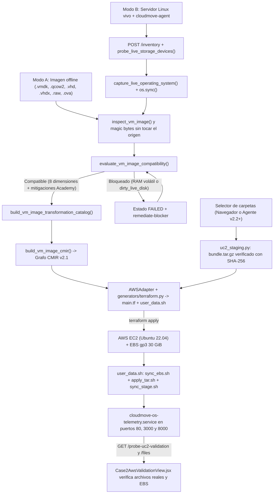
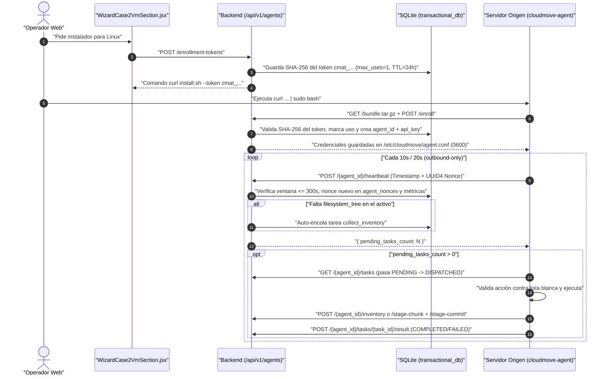
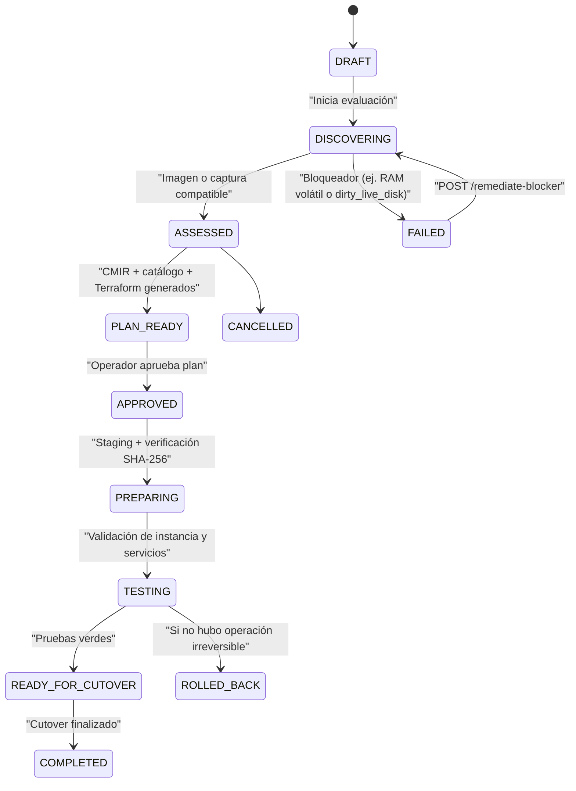

# CloudMove — Caso de Uso 2: Migración de Imágenes de VM, Captura de SO en Vivo y Agente Remoto

En el [README principal](file:///home/lacastrilp/Documentos/Semestre_2026_2/CapstoneProject_TI/README.md) ves la foto general de CloudMove, y en el [README del Caso 1](file:///home/lacastrilp/Documentos/Semestre_2026_2/CapstoneProject_TI/README_CASO_1.md) ves cómo migramos aplicaciones desde repositorios Git o carpetas de código. Aquí nos metemos de lleno en el **Caso de Uso 2 (`vm_image`)**: agarrar una máquina virtual completa o un servidor Linux encendido y levantarlo en AWS EC2 con Terraform y Cloud-Init.

Este caso tiene dos protagonistas que trabajan juntos: el motor de inspección y rehidratación en el backend, y el [agente instalable de CloudMove](file:///home/lacastrilp/Documentos/Semestre_2026_2/CapstoneProject_TI/cloudmove_agent/README.md) cuando el usuario quiere capturar un servidor real que está corriendo en producción o en su laboratorio. Para una guía archivo por archivo de todo el repositorio, también puedes consultar [docs/README.md](file:///home/lacastrilp/Documentos/Semestre_2026_2/CapstoneProject_TI/docs/README.md).

---

## Tabla de contenidos

- [1. Qué resuelve el Caso de Uso 2 y qué partes cubre](#1-qué-resuelve-el-caso-de-uso-2-y-qué-partes-cubre)
- [2. Vista general del flujo: de disco o agente a EC2](#2-vista-general-del-flujo-de-disco-o-agente-a-ec2)
- [3. Dónde vive cada pieza del código](#3-dónde-vive-cada-pieza-del-código)
- [4. El agente remoto (`cloudmove_agent/`): instalación, seguridad y ciclo de vida](#4-el-agente-remoto-cloudmove_agent-instalación-seguridad-y-ciclo-de-vida)
- [5. Modo A: inspección binaria de imágenes sin modificar el archivo origen](#5-modo-a-inspección-binaria-de-imágenes-sin-modificar-el-archivo-origen)
- [6. Modo B: captura en vivo y staging selectivo de archivos reales](#6-modo-b-captura-en-vivo-y-staging-selectivo-de-archivos-reales)
- [7. Validación de compatibilidad, bloqueadores, correcciones y las 8 dimensiones de fidelidad](#7-validación-de-compatibilidad-bloqueadores-correcciones-y-las-8-dimensiones-de-fidelidad)
- [8. Estrategia AWS, catálogo interactivo y las 4 protecciones de AWS Academy](#8-estrategia-aws-catálogo-interactivo-y-las-4-protecciones-de-aws-academy)
- [9. Del grafo CMIR v2.1 a Terraform y scripts multi-hipervisor](#9-del-grafo-cmir-v21-a-terraform-y-scripts-multi-hipervisor)
- [10. Arranque en EC2: rehidratación automática y portal web en vivo](#10-arranque-en-ec2-rehidratación-automática-y-portal-web-en-vivo)
- [11. Máquina de estados, control optimista y etapas del trabajo](#11-máquina-de-estados-control-optimista-y-etapas-del-trabajo)
- [12. Caso práctico real: `debian12-erp-prod` y flujo con agente](#12-caso-práctico-real-debian12-erp-prod-y-flujo-con-agente)
- [13. Referencia de endpoints API REST](#13-referencia-de-endpoints-api-rest)

---

## 1. Qué resuelve el Caso de Uso 2 y qué partes cubre

Cuando migras código (Caso 1), te enfocas en el runtime, el Dockerfile, las variables de entorno y la base de datos. En cambio, cuando migras un servidor completo o una máquina virtual (Caso 2), te enfrentas a discos virtuales pesados, tablas de particiones GPT o MBR, arranque UEFI o BIOS, controladores de disco NVMe, drivers de red, archivos en `/etc`, usuarios del sistema y servicios de `systemd`.

CloudMove resuelve dos escenarios reales bajo el mismo pipeline (`use_case = "vm_image"`):

1. **Modo A — Imagen de disco offline**: ya tienes un archivo de disco virtual exportado de VMware, VirtualBox, KVM o Proxmox (`.vmdk`, `.qcow2`, `.vhd`, `.vhdx`, `.raw`, `.ova` u `.ovf`), o un manifiesto de VM como [`debian12-erp-prod.manifest.json`](file:///home/lacastrilp/Documentos/Semestre_2026_2/CapstoneProject_TI/inventory/sample_images/debian12-erp-prod.manifest.json).
2. **Modo B — Servidor Linux vivo con agente + carpetas reales**: tienes una máquina corriendo (por ejemplo en tu red, en un laboratorio o en otra nube), instalas `cloudmove-agent` con un token de un solo uso y el panel web te deja ver sus discos, puertos, procesos y carpetas reales (`/home/*`, `/opt`, `/var/www`, `/srv`, `/etc`) para migrarlos hacia EC2 y un volumen EBS adicional.

> [!NOTE]
> **Qué se conserva y qué se reinicia en la nube (sin promesas falsas):**
> Al migrar discos o capturar un SO en caliente con búferes sincronizados (*quiesce* vía `os.sync()`), CloudMove conserva discos, particiones, puntos de montaje por `UUID=`, configuración en `/etc`, usuarios locales, paquetes y servicios habilitados en `systemd`. Lo que **nunca** viaja en una imagen de disco ni en una captura en caliente es la memoria RAM volátil ni las conexiones TCP abiertas en ese segundo; al arrancar en EC2, `systemd` levanta los servicios limpios desde disco, la VPC entrega una MAC e IP nueva y el hipervisor Nitro reemplaza el hardware virtual original.

---

## 2. Vista general del flujo: de disco o agente a EC2

En el pizarrón, el recorrido completo arranca por una de dos entradas —archivo binario o agente remoto— y termina con una instancia EC2 viva exponiendo los servicios y archivos migrados en su portal de telemetría:



---

## 3. Dónde vive cada pieza del código

Desde la modularización del backend, la lógica de UC2 y del agente ya no vive en un solo archivo gigante. Cada responsabilidad está separada así:

| Capa | Archivo | Qué hace exactamente |
| :--- | :--- | :--- |
| **API UC2** | [migration_uc2.py](file:///home/lacastrilp/Documentos/Semestre_2026_2/CapstoneProject_TI/backend/app/api/routers/migration_uc2.py) | Expone `/use-case-2/inspect`, `/use-case-2/devices`, `/use-case-2/probe-devices`, `/use-case-2/capture-live`, `/use-case-2/migrate`, remediación de bloqueadores, endpoints `/uc2-stage/*` y sondeo `/probe-uc2-*`. |
| **API Agentes** | [agents.py](file:///home/lacastrilp/Documentos/Semestre_2026_2/CapstoneProject_TI/backend/app/api/routers/agents.py) | Genera tokens de inscripción, sirve `/bundle.tar.gz`, `/install.sh` y `/install.ps1`, atiende `/enroll`, `/heartbeat`, `/tasks`, `/inventory` y `/stage-chunk` + `/stage-commit`. |
| **Motor UC2** | [image_migrator.py](file:///home/lacastrilp/Documentos/Semestre_2026_2/CapstoneProject_TI/backend/app/migration/image_migrator.py) | Valida compatibilidad y los 4 bloqueadores, arma las 8 dimensiones de fidelidad, construye el catálogo interactivo y el grafo CMIR v2.1, genera el reporte diff y produce los scripts multi-hipervisor. |
| **Sonda e inspección** | [uc2_live_probe.py](file:///home/lacastrilp/Documentos/Semestre_2026_2/CapstoneProject_TI/backend/app/migration/uc2_live_probe.py) | Lee cabeceras binarias (*magic bytes*), calcula SHA-256 *sparse*, copia y convierte imágenes en staging, consulta agentes remotos y ejecuta `capture_live_operating_system()`. |
| **Staging de archivos** | [uc2_staging.py](file:///home/lacastrilp/Documentos/Semestre_2026_2/CapstoneProject_TI/backend/app/migration/uc2_staging.py) | Recibe paquetes por chunks de 1 MiB (desde navegador o agente), verifica SHA-256 y anti-Tar-Slip, limpia sesiones viejas, y despacha `stage_selected_paths` o `push_selected_paths_to_ec2`. |
| **Portal y Cloud-Init** | [uc2_rehydration_portal.py](file:///home/lacastrilp/Documentos/Semestre_2026_2/CapstoneProject_TI/backend/app/migration/uc2_rehydration_portal.py) | Genera `user_data.sh` con `sync_ebs.sh`, `apply_tar.sh`, `sync_stage.sh` y `telemetry_server.py`, recortando contenido en 3 pasadas para nunca pasar el límite de 16 KB en EC2. |
| **MGN y VM Import** | [replication_and_import.py](file:///home/lacastrilp/Documentos/Semestre_2026_2/CapstoneProject_TI/backend/app/migration/replication_and_import.py) | Selecciona entre replicación continua (`aws_mgn`) e importación de imagen (`aws_vm_import`) y llama vía `boto3` a S3, EC2 (`ImportImage`) y MGN. |
| **Orquestación** | [orchestrator.py](file:///home/lacastrilp/Documentos/Semestre_2026_2/CapstoneProject_TI/backend/app/migration/orchestrator.py) | Controla la máquina de estados, el lock por etapa, la versión optimista, la remediación de bloqueadores (`remediate_compatibility_blocker`) y las transiciones del job. |
| **Seguridad & Catálogo** | [security.py](file:///home/lacastrilp/Documentos/Semestre_2026_2/CapstoneProject_TI/backend/app/core/security.py), [agents_catalog.py](file:///home/lacastrilp/Documentos/Semestre_2026_2/CapstoneProject_TI/backend/app/core/agents_catalog.py) | Identifica y oculta el propio servidor CloudMove (`is_control_plane_agent`) usando IMDSv2 + variables de entorno; compara versiones de agente y normaliza respuestas de live discovery. |
| **Persistencia SQLite** | [transactional_db.py](file:///home/lacastrilp/Documentos/Semestre_2026_2/CapstoneProject_TI/backend/app/persistence/transactional_db.py) | Guarda `agent_enrollment_tokens`, `agents`, `agent_nonces`, `agent_tasks` (con lista blanca cerrada), `audit_events` y las migraciones. |
| **Adaptador y HCL** | [aws_adapter.py](file:///home/lacastrilp/Documentos/Semestre_2026_2/CapstoneProject_TI/backend/app/adapters/aws_adapter.py), [terraform.py](file:///home/lacastrilp/Documentos/Semestre_2026_2/CapstoneProject_TI/backend/app/generators/terraform.py) | Convierte nodos CMIR (`virtual_machine`, `machine_image`, `disk`) a `aws_instance` (con `base64gzip(user_data.sh)`), `aws_ebs_volume`, `aws_ebs_snapshot_import` y `aws_ami`. |
| **Daemon del agente** | [agent_daemon.py](file:///home/lacastrilp/Documentos/Semestre_2026_2/CapstoneProject_TI/cloudmove_agent/agent_daemon.py), [system_collector.py](file:///home/lacastrilp/Documentos/Semestre_2026_2/CapstoneProject_TI/cloudmove_agent/system_collector.py), [installer.py](file:///home/lacastrilp/Documentos/Semestre_2026_2/CapstoneProject_TI/cloudmove_agent/installer.py) | Daemon `cloudmove-agent` v2.2.0 (`systemd`), inventario real del host (`lsblk`, `ss`, `systemctl`, árbol de archivos) e instalador CLI Python. |
| **Frontend UC2** | [WizardCase2VmSection.jsx](file:///home/lacastrilp/Documentos/Semestre_2026_2/CapstoneProject_TI/frontend/src/components/migration/WizardCase2VmSection.jsx), [Case2InspectionPanels.jsx](file:///home/lacastrilp/Documentos/Semestre_2026_2/CapstoneProject_TI/frontend/src/components/migration/Case2InspectionPanels.jsx), [UserFileSelectionPanel.jsx](file:///home/lacastrilp/Documentos/Semestre_2026_2/CapstoneProject_TI/frontend/src/components/migration/UserFileSelectionPanel.jsx), [Uc2StageTransferBox.jsx](file:///home/lacastrilp/Documentos/Semestre_2026_2/CapstoneProject_TI/frontend/src/components/migration/Uc2StageTransferBox.jsx), [VmOsToCloudTransformationMap.jsx](file:///home/lacastrilp/Documentos/Semestre_2026_2/CapstoneProject_TI/frontend/src/components/migration/VmOsToCloudTransformationMap.jsx), [Case2AwsValidationView.jsx](file:///home/lacastrilp/Documentos/Semestre_2026_2/CapstoneProject_TI/frontend/src/components/migration/Case2AwsValidationView.jsx) | Flujo visual completo en el wizard: generación de token e instalador, explorador de carpetas del servidor, progreso de staging por chunks, catálogo AWS Academy, mapa VM-a-Nube y panel de verificación remota contra la EC2 desplegada. |

---

## 4. El agente remoto (`cloudmove_agent/`): instalación, seguridad y ciclo de vida

Como CloudMove corre publicado en AWS para que distintos usuarios entren desde su navegador, no tiene acceso directo a las máquinas privadas de esos usuarios. Por eso el agente trabaja con **comunicación saliente únicamente** (*outbound-only*): el servidor origen es quien llama por HTTPS/HTTP al backend de CloudMove, nunca al revés. Así no hace falta abrir puertos entrantes ni exponer SSH del servidor origen hacia internet.

### 4.1 Token de inscripción de un solo uso y descarga dinámica

Todo empieza cuando el usuario pide un token desde la UI (`POST /api/v1/agents/enrollment-tokens`). En [`transactional_db.py`](file:///home/lacastrilp/Documentos/Semestre_2026_2/CapstoneProject_TI/backend/app/persistence/transactional_db.py):

- Se genera una clave aleatoria `cmat_<32_bytes_urlsafe>`.
- La base de datos **no guarda el token en texto plano**: almacena su hash SHA-256 en `agent_enrollment_tokens`, junto con `token_prefix` (los primeros 12 caracteres + `...`), `max_uses` (por defecto `1`) y `expires_at` (`ttl_seconds = 86400`, o sea 24 horas).
- El endpoint devuelve el comando listo para copiar y pegar en el servidor origen:

```bash
curl -sSL https://tu-servidor-cloudmove/api/v1/agents/install.sh | sudo bash -s -- --token cmat_...
```

Al ejecutarse `install.sh` (servido dinámicamente por `GET /api/v1/agents/install.sh` con la URL del servidor validada por regex y escapada con `shlex.quote`), el script:
1. Descarga el paquete Python actualizado desde `GET /api/v1/agents/bundle.tar.gz` hacia `/opt/cloudmove-agent/cloudmove_agent`.
2. Lee la IP primaria real, el hostname (`platform.node()` / `socket.gethostname()`) y el `/etc/machine-id` si existe.
3. Llama a `POST /api/v1/agents/enroll` enviando el `enrollment_token` y declarando `version: "2.2.0"`. Si usas Windows, existe el equivalente [install.ps1](file:///home/lacastrilp/Documentos/Semestre_2026_2/CapstoneProject_TI/cloudmove_agent/install.ps1), y para instalaciones manuales en Python está [`installer.py`](file:///home/lacastrilp/Documentos/Semestre_2026_2/CapstoneProject_TI/cloudmove_agent/installer.py).

### 4.2 Credenciales del agente y endurecimiento con `systemd`

Cuando el backend verifica el hash SHA-256 del token y comprueba que no venció ni superó `max_uses`, registra el equipo en la tabla `agents` y le entrega un `agent_id` y una llave `agent_api_key` permanente (revocable en cualquier momento).

El instalador guarda esa configuración en `/etc/cloudmove/agent.conf` con permisos `chmod 600` (y `heartbeat_interval = 10`, aunque el constructor de [`CloudMoveAgentDaemon`](file:///home/lacastrilp/Documentos/Semestre_2026_2/CapstoneProject_TI/cloudmove_agent/agent_daemon.py#L93-L108) toma `20` segundos si se ejecuta directo sin archivo de configuración). Además, registra el servicio `/etc/systemd/system/cloudmove-agent.service` con dos protecciones del propio kernel Linux vía `systemd`:

- `NoNewPrivileges=true`
- `ProtectSystem=full` (monta `/usr`, `/boot` y `/etc` en modo solo lectura para el servicio)
- Reinicio automático (`Restart=always`, `RestartSec=10`) y logs en `/var/log/cloudmove/agent.log`.

### 4.3 Aislamiento del plano de control (`is_control_plane_agent`)

Aquí hay una regla crítica de seguridad multiusuario que vive en [`security.py`](file:///home/lacastrilp/Documentos/Semestre_2026_2/CapstoneProject_TI/backend/app/core/security.py#L186-L273). Imagina que alguien prueba CloudMove en línea desde AWS y no instaló ningún agente todavía. Sin una barrera clara, una llamada a `/use-case-2/probe-devices` o a `/api/v1/agents/live-discovery` podría terminar leyendo los discos o el `/home` de la propia instancia EC2 donde está alojado CloudMove.

Para impedir eso por diseño:
- `get_control_plane_metadata()` consulta de forma dinámica al arrancarse el servicio **EC2 IMDSv2** (`http://169.254.169.254/latest/api/token` con timeout de `0.25s`) para conocer su propio `instance-id`, `public-ipv4` y `local-ipv4`, y los combina con variables de entorno opcionales (`CLOUDMOVE_PROTECTED_INSTANCE_IDS`, `CLOUDMOVE_PROTECTED_VPC_IDS`, `CLOUDMOVE_CONTROL_PLANE_IPS`, `CLOUDMOVE_CONTROL_PLANE_HOSTS` y `CLOUDMOVE_API_URL`).
- `is_control_plane_agent(agent)` devuelve `True` si el hostname coincide con nombres reservados (`cloudmove-server`, `localhost`, `127.0.0.1`, el host de la API), si tiene forma de ID de contenedor Docker (`[0-9a-f]{12}`), o si su IP coincide con las protegidas.
- Tanto `probe_live_storage_devices()` como `_find_active_remote_agent()` en [`uc2_staging.py`](file:///home/lacastrilp/Documentos/Semestre_2026_2/CapstoneProject_TI/backend/app/migration/uc2_staging.py#L551-L567) y los endpoints de descubrimiento filtran fuera cualquier agente del plano de control. Si no hay un agente remoto externo en línea, `probe_live_storage_devices` responde `requires_agent_enrollment: True` y no expone nada del servidor central.

### 4.4 Heartbeat, protección anti-replay y secuencia de trabajo

En cada ciclo, el agente manda su estado con cuatro cabeceras HTTP clave:

| Cabecera | Qué lleva | Para qué sirve |
| :--- | :--- | :--- |
| `Authorization` | `Bearer <api_key>` | Autentica al agente contra su hash/clave registrada y valida que no esté `REVOKED`. |
| `X-Agent-ID` | `agent_id` | Identifica el registro del host en SQLite. |
| `X-Agent-Timestamp` | Fecha UTC en ISO 8601 | Si la diferencia con el reloj del servidor supera **`300` segundos** (5 minutos), el backend rechaza la petición como posible ataque *replay*. |
| `X-Agent-Nonce` | `uuid4()` único por petición | Se inserta en la tabla `agent_nonces` (`UNIQUE` por agente + nonce); si alguien intercepta y reenvía la misma petición dentro de los 5 minutos, SQLite lanza `IntegrityError` y se bloquea. Los nonces viejos de más de `600` segundos se limpian solos. |

Cuando el servidor recibe un heartbeat y detecta que el inventario del agente aún no tiene `filesystem_tree` (y no hay tareas `PENDING`), encola automáticamente la tarea `collect_inventory`.



### 4.5 Lista blanca cerrada de acciones y qué recolecta `system_collector.py`

Por política de seguridad, **el agente rechaza cualquier orden arbitraria de shell**. Tanto el backend al crear tareas (`create_agent_task` en [`transactional_db.py`](file:///home/lacastrilp/Documentos/Semestre_2026_2/CapstoneProject_TI/backend/app/persistence/transactional_db.py#L1218-L1233)) como el daemon al recibirlas (`_execute_single_task` en [`agent_daemon.py`](file:///home/lacastrilp/Documentos/Semestre_2026_2/CapstoneProject_TI/cloudmove_agent/agent_daemon.py#L223-L244)) exigen que `action` esté dentro de la lista permitida:

| Acción permitida | Qué hace en el host |
| :--- | :--- |
| `collect_inventory` | Ejecuta `collect_system_inventory()` de [`system_collector.py`](file:///home/lacastrilp/Documentos/Semestre_2026_2/CapstoneProject_TI/cloudmove_agent/system_collector.py#L677-L740) y sube el resultado a `POST /api/v1/agents/{agent_id}/inventory`. |
| `inspect_disk` | Revisa geometría de discos, particiones, tamaños y UUIDs con `collect_disks_and_mounts()`. |
| `check_mgn_prerequisites` | Prueba conectividad TCP saliente hacia `mgn.<region>.amazonaws.com:443` sin simular éxito si hay bloqueo de firewall. |
| `quiesce_database` / `unquiesce_database` | Llama a `libc.sync()` de forma segura para vaciar búferes pendientes a disco antes de una captura. |
| `stage_selected_paths` | Empaqueta las carpetas seleccionadas en un `.tar.gz` acotado y las envía en chunks de `1 MiB` al backend de CloudMove. |
| `push_selected_paths_to_ec2` | Empaqueta y sube en chunks de `1 MiB` directamente al puerto `3000` de la nueva instancia EC2 usando `X-CloudMove-Sync-Token`. |
| `self_update` | Descarga `GET /api/v1/agents/bundle.tar.gz`, actualiza el código del paquete y termina limpio para que `systemd` reinicie la nueva versión. |
| `install_mgn_agent` / `capture_live_os` | Reservadas en esquema/política: el daemon remoto actual delega la captura de archivos en `stage_selected_paths` y rechaza acciones fuera de su bloque permitido. |

Cuando corre `collect_system_inventory()`, [`system_collector.py`](file:///home/lacastrilp/Documentos/Semestre_2026_2/CapstoneProject_TI/cloudmove_agent/system_collector.py#L631-L740) marca el paquete con `"evidence_provenance": "observed_by_cloudmove_agent"` y reúne:
- Identidad estable (`hostname` real y `machine_id`), familia de SO, arquitectura y versión del kernel.
- CPU, RAM (`/proc/meminfo`) y discos/particiones (`lsblk` + puntos de montaje).
- Interfaces de red, puertos escuchando, servicios de `systemd` (hasta `120`), procesos activos (hasta `80`), runtimes detectados (`python3`, `node`, `java`, `go`, `docker`) y bases de datos locales.
- **Árbol de carpetas (`collect_filesystem_tree`)**: recorre cada usuario en `/home/*` (hasta `4` niveles de profundidad, máx. `60` hijos por nivel) y las rutas `/opt`, `/var/www`, `/srv` y `/etc` (`1` nivel, `20` hijos), devolviendo tamaños e hijos para que el usuario elija en la web qué carpetas quiere migrar.

---

## 5. Modo A: inspección binaria de imágenes sin modificar el archivo origen

Si el usuario sube o apunta a una imagen de disco (`.vmdk`, `.qcow2`, `.vhd`, `.vhdx`, `.raw`, `.ova`, `.ovf`), CloudMove jamás abre el archivo en modo escritura ni hace manipulaciones destructivas sobre la fuente (`source_modified = False`).

### 5.1 Lectura de cabeceras reales (*magic bytes*) y detección de stubs falsos

En [`uc2_live_probe.py`](file:///home/lacastrilp/Documentos/Semestre_2026_2/CapstoneProject_TI/backend/app/migration/uc2_live_probe.py#L62-L207), `inspect_binary_disk_header_and_structure(path)` lee únicamente los primeros `4096` bytes (`header`) y un bloque de muestra de `262144` bytes (256 KiB) para confirmar que la imagen es real y no un archivo de texto disfrazado:

| Formato | Firma / Bytes inspeccionados | Qué extrae o valida |
| :--- | :--- | :--- |
| **VMDK (Sparse binario)** | `header[0:4] == b"KDMV"` | Lee versión, flags y capacidad lógica en sectores (`struct.unpack("<IIQ", header[4:20])`). |
| **VMDK (Descriptor ASCII)** | Empieza por `# Disk DescriptorFile` o `# VMDK DiskDescriptorFile` | Busca las líneas de extents reales (`RW ... SPARSE/FLAT "archivo.vmdk"`). Si el `.vmdk` binario no existe junto al descriptor, lo clasifica como `VMDK_TEXT_STUB` (`simulated_text_stub_missing_extent`). |
| **QCOW2** | `header[0:4] == b"QFI\xfb"` | Lee versión (`>I` en bytes `4..8`, usualmente `v2` o `v3`) y tamaño virtual en bytes (`>Q` en `24..32`). |
| **VHD** | `header[0:8] == b"conectix"` | Reconoce cabecera/pie fijo de Virtual Hard Disk (`conectix`). |
| **VHDX** | `header[0:8] == b"vhdxfile"` | Reconoce cabecera Hyper-V `vhdxfile`. |
| **RAW (MBR / GPT)** | `header[510:512] == b"\x55\xaa"` y/o `header[512:520] == b"EFI PART"` | Valida firma de sector de arranque MBR y tabla GPT EFI. |
| **OVA** | `header[257:262] == b"ustar"` | Reconoce empaquetado TAR POSIX `ustar` del appliance OVA. |
| **OVF** | `<Envelope` o `<ovf:Envelope` en el encabezado UTF-8 | Valida XML descriptor OVF. |

Además, sobre el bloque de `262144` bytes busca etiquetas de particiones GPT codificadas en **UTF-16LE** (`EFI-SYSTEM`, `LINUX-ROOT`, `PGSQL-DATA`, `BOOT`, `ROOT`) y ejecuta `/usr/bin/qemu-img info -U --output=json` en solo lectura cuando `qemu-img` está instalado.

### 5.2 Hashing SHA-256 rápido en imágenes *sparse* y copia segura a staging

Una imagen de disco virtual puede declarar 50 GiB virtuales pero ocupar solo unos megabytes reales (*sparse file*, donde los bloques no escritos son ceros virtuales). Para no bloquear el servidor leyendo gigabytes de ceros:

- `_compute_file_sha256(path)` revisa `st_blocks * 512`. Si el archivo supera `5 GiB` de tamaño aparente (`st_size > 5 * 1024^3`) pero ocupa menos de `50 MiB` en bloques físicos reales, calcula el SHA-256 de la parte asignada más un marcador `:sparse_len:<st_size>` para mantener unicidad sin congelar la CPU. En archivos normales, hashea en bloques de `1 MiB`.
- Cuando hace falta preparar la imagen antes de subirla o importarla, `prepare_and_verify_staging_copy()` copia el disco hacia `generated/staging_images/<slug>/` usando `cp --sparse=always` (para imágenes grandes sparse) o `shutil.copy2`, vuelve a verificar el SHA-256 y, si el formato no es aceptado directamente por `ec2:ImportImage` (`AWS_NATIVE_IMPORT_FORMATS = {"VMDK", "VHD", "VHDX", "RAW", "OVA"}`), ejecuta `qemu-img convert` (por ejemplo de `QCOW2` a `RAW`) exclusivamente sobre la copia de staging.

---

## 6. Modo B: captura en vivo y staging selectivo de archivos reales

Cuando el usuario no parte de un `.vmdk` offline sino de su servidor vivo conectado mediante `cloudmove-agent`, entran en juego dos piezas distintas:

1. **Captura de metadatos e imagen de sistema (`capture_live_operating_system`)** en [`uc2_live_probe.py`](file:///home/lacastrilp/Documentos/Semestre_2026_2/CapstoneProject_TI/backend/app/migration/uc2_live_probe.py#L1285-L1760):
   - Llama primero a `probe_live_storage_devices(agent_id=...)` —que exige un agente remoto enrolado, protegiendo el plano de control—.
   - Ejecuta `os.sync()` para dejar el snapshot en estado `application_quiesced_snapshot`.
   - Crea la imagen base con `qemu-img create` (o escribe cabecera binaria `QFI\xfb` / MBR+GPT real si `qemu-img` no está presente en el entorno).
   - Recolecta `/etc/passwd` (`_probe_real_users`), interfaces de red (`ip -j addr`), paquetes instalados, procesos y puertos en escucha, tareas programadas, servicios `systemd` y configuraciones clave en `/etc/` (`/etc/os-release`, `/etc/fstab`, `/etc/hostname`, `/etc/hosts`, `/etc/resolv.conf`, `/etc/default/grub`, `/etc/sysctl.conf`, `/etc/security/limits.conf`, `/etc/environment`, `/etc/ssh/sshd_config` y overrides en `/etc/systemd/system/*.service`), empaquetándolo en `system_image_snapshot_<host>.tar.gz`.

2. **Staging de carpetas y archivos reales elegidos por el usuario ([`uc2_staging.py`](file:///home/lacastrilp/Documentos/Semestre_2026_2/CapstoneProject_TI/backend/app/migration/uc2_staging.py))**:
   AWS EC2 limita `user_data` a **16,384 bytes**. Obviamente ahí no caben 500 MB o 4 GB de carpetas de `/home/usuario` o `/var/www`. Para superar ese límite sin perder archivos reales, CloudMove soporta dos caminos:

   - **Desde el agente v2.2.0+ (`stage_selected_paths`)**:
     Cuando corres `POST /use-case-2/inspect`, `POST /uc2-stage/dispatch-agent` o `ensure_uc2_selected_paths_staged()`, el backend verifica que el agente esté en `v2.2.0` o superior (`is_version_gte`) y le envía la tarea `stage_selected_paths`. El agente:
     1. Recorre las rutas pedidas con `_pack_selected_paths()` sin seguir enlaces simbólicos (`followlinks=False`), limitando a `12,000` archivos por lote.
     2. Salta directorios de dependencias o cachés pesadas (`_SKIP_WALK_DIRS = {".git", "node_modules", ".cache", "__pycache__", ".venv", "venv"}`).
     3. **Excluye credenciales sensibles automáticamente**: cualquier ruta que contenga `_SENSITIVE_NAME_TOKENS` (`.ssh/id_`, `.aws/credentials`, `id_rsa`, `id_ed25519`) o archivos `.env` queda fuera con motivo `sensitive_credential_excluded` para no subir llaves privadas por accidente.
     4. Ordena los archivos de menor a mayor tamaño (`candidates.sort(key=lambda item: (item[0], item[1]))`) para asegurar que los documentos livianos entren primero y nunca queden desplazados por un instalador enorme.
     5. Añade el resumen `var/log/cloudmove_selected_paths_inventory.json` dentro del `.tar.gz`, lo divide en fragmentos binarios de **1 MiB** con `_stream_tar_chunks()` mientras calcula el SHA-256 global, y sube cada pieza a `POST /api/v1/agents/{agent_id}/stage-chunk` antes de cerrar con `stage-commit`.
     6. En el backend, `commit_stage_archive()` concatena los fragmentos, verifica que el SHA-256 coincida, recorre el `.tar.gz` con `_inspect_and_validate_tarball()` aplicando `_safe_rel_path()` para bloquear intentos de *Path Traversal / Tar-Slip* (`..`), respeta un tope por stage (`DEFAULT_MAX_STAGE_BYTES = 15 GiB`) y reserva al menos `MIN_FREE_DISK_BYTES = 4 GiB` libres en el disco del servidor CloudMove (`prune_old_stages(keep_latest=3)` borra stages viejos automáticamente).

   - **Desde el navegador (`browser_upload`)**:
     Si el usuario selecciona una carpeta local directamente en [`UserFileSelectionPanel.jsx`](file:///home/lacastrilp/Documentos/Semestre_2026_2/CapstoneProject_TI/frontend/src/components/migration/UserFileSelectionPanel.jsx) y [`Uc2StageTransferBox.jsx`](file:///home/lacastrilp/Documentos/Semestre_2026_2/CapstoneProject_TI/frontend/src/components/migration/Uc2StageTransferBox.jsx), el frontend inicializa una sesión (`POST /uc2-stage/init`), manda lotes en JSON/Base64 (`POST /uc2-stage/{stage_id}/upload-files`) y cierra con `POST /uc2-stage/{stage_id}/commit`, generando un `bundle.tar.gz` idéntico listo para la instancia EC2.

   - **Modo empuje directo a EC2 (`push_selected_paths_to_ec2`)**:
     Si el volumen de archivos supera el presupuesto disponible en el servidor CloudMove (por ejemplo hasta `24,000` MiB o `1024` MiB por archivo), `dispatch_push_to_ec2()` instruye al agente para transmitir los chunks de `1 MiB` directamente al puerto `3000` de la nueva EC2 (`POST /upload-chunk` + `POST /upload-commit`) usando `X-CloudMove-Sync-Token` una vez que la máquina ya arrancó en AWS.

---

## 7. Validación de compatibilidad, bloqueadores, correcciones y las 8 dimensiones de fidelidad

Con el manifiesto en mano (sea de una imagen offline o de captura en vivo), `evaluate_vm_image_compatibility()` en [`image_migrator.py`](file:///home/lacastrilp/Documentos/Semestre_2026_2/CapstoneProject_TI/backend/app/migration/image_migrator.py#L315-L525) audita la migración antes de generar infraestructura.

### 7.1 Los 4 bloqueadores que detienen la migración

1. **Imagen simulada o descriptor huérfano (`simulated_text_stub_missing_extent`)**: cuando `require_authentic_binary=True` y el archivo `.vmdk` es solo texto sin extent binario acompañante.
2. **Disco en caliente sin consistencia (`dirty_live_disk` o `source_running_during_raw_copy=True`)**: si alguien copió un disco mientras PostgreSQL o el sistema seguían escribiendo sin `fsfreeze`/VSS ni `sync()`, el motor bloquea el avance porque la base o el filesystem quedarían corruptos.
3. **Conjunto multi-disco incompleto (`missing_disk_files`)**: si la VM tiene disco de sistema y disco de datos (como `/dev/sda` + `/dev/sdb`) y falta alguno de los archivos.
4. **Exigencia de memoria RAM volátil en caliente (`require_live_memory_state=True`)**: porque la importación de disco ni la captura en vivo transfieren páginas activas de RAM ni descriptores de sockets abiertos.

Si una migración cae en estado `FAILED` por `require_live_memory_state`, el operador o el frontend puede disparar `POST /api/v1/migration/jobs/{migration_id}/remediate-blocker` (atendido por `remediate_compatibility_blocker()` en [`orchestrator.py`](file:///home/lacastrilp/Documentos/Semestre_2026_2/CapstoneProject_TI/backend/app/migration/orchestrator.py#L977-L1031)) eligiendo:
- `apply_quiesced_snapshot`: adopta snapshot consistente *quiesced* (`sync()` + reinicio limpio de servicios en la nube).
- `switch_continuous_replication`: activa `prefer_continuous_replication=True` para orquestar vía AWS MGN cuando el origen es compatible.

El orquestador limpia los bloqueadores, registra el evento en el log de auditoría y vuelve a correr la evaluación y generación de plan automáticamente.

### 7.2 Remediaciones programadas sobre la copia de staging

Sin tocar el disco origen, `evaluate_vm_image_compatibility()` programa cuatro ajustes técnicos (`boot_and_driver_remediations`) para garantizar que el Linux arranque en hipervisores AWS Nitro:

| Ajuste | Qué corrige | Comando / Cambio en staging |
| :--- | :--- | :--- |
| **Conversión de formato** | `QCOW2` / `OVF` no soportados nativamente por `ec2:ImportImage`. | `qemu-img convert -p -f qcow2 -O raw ...` + verificación SHA-256. |
| **Inyección de drivers Nitro** | Imágenes antiguas sin módulos `ena` o `nvme`. | `dracut --add-drivers 'ena nvme nvme_core' -f` o `update-initramfs -u -k all`. |
| **Normalización de `/etc/fstab`** | Entradas como `/dev/sda2` o `/dev/vda1` fallan al renombrarse a `/dev/nvme0n1p1` en Nitro. | Reemplazo a identificadores `UUID=`. |
| **Red cloud + consola serie** | Reglas MAC fijas en `udev` o IP estática incompatible con la VPC. | Habilita DHCP, limpia reglas MAC fijas y agrega `GRUB_CMDLINE_LINUX_DEFAULT='console=tty0 console=ttyS0,115200n8'`. |

### 7.3 Las 8 dimensiones de fidelidad y reporte Origen vs. Destino

Cada inspección devuelve la matriz de **8 dimensiones** y un reporte detallado (`generate_source_vs_target_diff_report()` en [`image_migrator.py`](file:///home/lacastrilp/Documentos/Semestre_2026_2/CapstoneProject_TI/backend/app/migration/image_migrator.py#L1177-L1273)) con `"declares_absolute_hardware_equivalence": false`, dejando claro qué es idéntico y qué se adapta por naturaleza al pasar a AWS:

1. **Contenido de discos y esquema de particiones** -> `EXACT_MATCH` (bloque a bloque + SHA-256).
2. **Sistemas de archivos y puntos de montaje** -> `EXACT_MATCH` (por `UUID=` aunque el bus cambie de `/dev/sd*` a `/dev/nvme*`).
3. **Sistema operativo, kernel y paquetes** -> `EXACT_MATCH` (`/usr`, `/opt`, `/var`, librerías intactas).
4. **Configuración persistente (`/etc`, usuarios, cron)** -> `EXACT_MATCH`.
5. **Identidad de red y hardware virtual** -> `EXPECTED_CLOUD_ADAPTATION` (cambia MAC a NIC virtual ENA, cambia IP a DHCP de la subred VPC, cambia UUID SMBIOS).
6. **Servicios `systemd` y puertos en escucha** -> `EXACT_MATCH` (arrancan automáticamente al iniciar).
7. **Memoria RAM volátil y sockets TCP activos** -> `EXPECTED_NON_TRANSFERRED_VOLATILE_STATE`.
8. **Compatibilidad de instancia destino y modo de arranque (`UEFI`/`BIOS`)** -> `EXACT_MATCH`.

---

## 8. Estrategia AWS, catálogo interactivo y las 4 protecciones de AWS Academy

### 8.1 Matriz oficial AWS: MGN vs. VM Import/Export vs. Rehidratación Autónoma

En [`replication_and_import.py`](file:///home/lacastrilp/Documentos/Semestre_2026_2/CapstoneProject_TI/backend/app/migration/replication_and_import.py#L39-L185), `select_machine_migration_strategy()` decide con base en la tabla `MACHINE_MIGRATION_COMPATIBILITY_MATRIX["aws"]`:

- **`aws_mgn` (AWS Application Migration Service)**: elegida cuando `prefer_continuous_replication=True` **y** el origen es un servidor vivo o VM de hipervisor (`live_server`, `hypervisor_vm`, `datacenter_host`) Linux o Windows en `x86_64` / `arm64`. Requiere TCP `443` hacia `mgn.<region>.amazonaws.com` y TCP `1500` hacia instancias de replicación en la subred de staging. Nunca aplica para un archivo `.vmdk`/`.qcow2` suelto sin máquina activa (`standalone_offline_disk_image`).
- **`aws_vm_import` (`ec2:ImportImage` / `ec2:ImportSnapshot`)**: vía oficial para imágenes en frío (`VMDK`, `VHD`, `VHDX`, `RAW`, `OVA`). Sube el disco a Amazon S3 y usa `AWSMachineMigrationClient` (`boto3` `s3` + `ec2`) exigiendo el rol IAM `vmimport` con política de confianza hacia `vmie.amazonaws.com`.
- **`autonomous_cloud_init` (Modo predeterminado seguro en CloudMove)**: cuando estás en una captura en vivo o en cuentas educativas como **AWS Academy Learner Lab** donde `iam:CreateRole` está bloqueado y no existe el rol `vmimport`, Terraform levanta una instancia directa con Ubuntu 22.04 LTS (`enable_vm_import = false`) y reconstruye configuraciones, usuarios, scripts, discos EBS y archivos reales vía `user_data.sh`.

### 8.2 Catálogo interactivo y las 4 protecciones preventivas para AWS Academy

`build_vm_image_transformation_catalog()` ([`image_migrator.py`](file:///home/lacastrilp/Documentos/Semestre_2026_2/CapstoneProject_TI/backend/app/migration/image_migrator.py#L553-L815)) presenta al operador opciones editables —tamaño de volumen EBS (`free_tier_t3_micro` 30 GiB, 100 GiB o tamaño original), modo de cómputo (`autonomous_cloud_init`, `native_ami_vm_import`, `ha_launch_template_asg`), perfil de instancia (`t3.micro`, `t3.medium`, `t3.xlarge`) y política de puertos— y aplica automáticamente **cuatro protecciones reales** contra fallos típicos al desplegar en AWS Academy (`Pvoclabs2`):

1. **Límite de tamaño EBS (`Pvoclabs2 <= 100 GiB`)**: un portátil o servidor físico suele tener discos de `250 GiB`, `465 GiB` o `120 GiB`. En AWS Academy, pedir un `aws_ebs_volume` o `root_block_device` mayor a 100 GiB falla al instante con `403 UnauthorizedOperation` en `ec2:CreateVolume`. CloudMove aprovisiona por defecto `30 GiB gp3` cifrado (Free Tier) o hasta `100 GiB` si el usuario lo elige, guardando siempre la capacidad real del origen en la etiqueta `Source_Capacity_GiB`.
2. **Deduplicación del puerto `22` en Security Groups**: un escaneo real (`ss -tulpn`) detecta `sshd` en el puerto `22`. Si se vuelve a agregar el puerto `22` aparte de la regla fija de administración SSH, AWS rechaza la creación con `InvalidParameterValue` por regla duplicada. El catálogo deduplica el `22` y filtra puertos efímeros `>= 32768`, dejando un máximo de 15 puertos limpios.
3. **Bypass del rol IAM `vmimport`**: como `iam:CreateRole` está restringido en Learner Lab, `enable_vm_import` arranca en `false` para no fallar creando roles ni importando snapshots si el usuario no proporcionó un bucket S3 con `vmimport` preconfigurado.
4. **Compresión y recorte para el límite de `16,384` bytes en `user_data`**: EC2 rechaza `RunInstances` si `user_data` supera 16 KB. CloudMove usa `base64gzip` en Terraform **y** ejecuta en [`uc2_rehydration_portal.py`](file:///home/lacastrilp/Documentos/Semestre_2026_2/CapstoneProject_TI/backend/app/migration/uc2_rehydration_portal.py#L590-L638) un recorte progresivo en **3 pasadas** garantizando que el script comprimido pese `<= 15800` bytes:
   - *Pasada 1*: incrusta manifiesto completo + hasta `40` archivos clave de `/etc` (excluyendo `/etc/ssh/sshd_config` o claves), hasta `10 KB` de texto si cabe.
   - *Pasada 2*: si al comprimir pasa de `15800` bytes, conserva el resumen del sistema pero recorta los listados largos (`running_processes`, `installed_packages`, `filesystem_tree`) y deja hasta `15` archivos críticos.
   - *Pasada 3*: si aún excede, comprime un manifiesto mínimo de identidad (`image_id`, `hostname`, `stage_id`, `sync_token`) y delega el grueso de archivos al paquete staged descargado por HTTP tras el arranque.

---

## 9. Del grafo CMIR v2.1 a Terraform y scripts multi-hipervisor

### 9.1 Nodos y relaciones del CMIR v2.1 (`build_vm_image_cmir`)

Antes de escribir HCL, `build_vm_image_cmir()` ([`image_migrator.py`](file:///home/lacastrilp/Documentos/Semestre_2026_2/CapstoneProject_TI/backend/app/migration/image_migrator.py#L914-L1127)) construye un grafo neutral respecto al proveedor:

- **Nodo `machine_image`**: representa la imagen o captura completa (`img-{slug}`), con `boot_mode`, `partition_scheme`, `os`, `sha256`, `stage_id` y la bandera `enable_vm_import_default`.
- **Nodo `virtual_machine`**: representa el servidor destino (`vm-{slug}`), enlazado por `migrates_to`, con `root_volume_size_gb`, puertos de entrada seleccionados y perfil de instancia.
- **Nodos `disk`**: uno por cada disco en `disks` (`disk-{slug}-{order}`), conectados por `mounts`, conservando `size_gib` original y `provisioned_size_gib` seguro para AWS.
- **Nodos `system_service`**: los servicios detectados (`svc-{slug}-{name}`) unidos mediante `runs_on` a la máquina virtual.

### 9.2 Traducción a Terraform (`AWSAdapter` + `generators/terraform.py`)

El [`AWSAdapter`](file:///home/lacastrilp/Documentos/Semestre_2026_2/CapstoneProject_TI/backend/app/adapters/aws_adapter.py#L13-L40) mapea `virtual_machine -> aws_instance`, `machine_image -> aws_ami` y `disk -> aws_ebs_volume`. Luego [`terraform.py`](file:///home/lacastrilp/Documentos/Semestre_2026_2/CapstoneProject_TI/backend/app/generators/terraform.py#L673-L920) genera los recursos reales listos para aplicar:

```hcl
resource "aws_instance" "vm_debian12_erp_prod" {
  ami                         = var.ami_id != "" ? var.ami_id : (var.enable_vm_import ? aws_ami.img_debian12[0].id : data.aws_ami.ubuntu.id)
  instance_type               = var.instance_type
  subnet_id                   = aws_subnet.public_subnet.id
  vpc_security_group_ids      = [aws_security_group.app_sg.id]
  associate_public_ip_address = true
  user_data_base64            = base64gzip(file("${path.module}/user_data.sh"))
  user_data_replace_on_change = true

  root_block_device {
    volume_size           = 30
    volume_type           = "gp3"
    encrypted             = true
    delete_on_termination = true
  }
}

resource "aws_ebs_volume" "disk_debian12_erp_prod_2" {
  availability_zone = "${var.aws_region}a"
  size              = 30
  type              = "gp3"
  encrypted         = true
  tags = {
    Name                = "disk-debian12-erp-prod-2"
    Source_Capacity_GiB = "120"
    ManagedBy           = "CloudMove"
  }
}

resource "aws_volume_attachment" "disk_debian12_erp_prod_2_attach" {
  device_name  = "/dev/sdg"
  volume_id    = aws_ebs_volume.disk_debian12_erp_prod_2.id
  instance_id  = aws_instance.vm_debian12_erp_prod.id
  force_detach = true
}
```

Además, si `enable_vm_import = true` y especificas `vm_import_s3_bucket`, Terraform incluye de forma condicional `aws_ebs_snapshot_import` + `aws_ami` apuntando al disco subido a S3 con `role_name = "vmimport"` y `ena_support = true`.

### 9.3 Scripts operativos y multi-hipervisor generados

`generate_vm_image_migration_artifacts()` también escribe en el paquete de artefactos los scripts listos para usar tanto en AWS como en hipervisores locales:

- `deploy_to_aws.sh` / `import_image_aws.sh`: crea el bucket S3, arma la trust policy de `vmimport`, lanza `aws ec2 import-image`, consulta el progreso hasta obtener `AMI_ID` y corre `terraform init && terraform apply`.
- `create_full_raw_disk_clone.sh`: permite modo `local` (`qemu-img convert -c` o `dd | gzip` + `sha256sum`) o modo `s3` (streaming directo hacia S3 con `sfdisk -d` de respaldo).
- `restore_system_image.sh`: reconstruye `/etc`, cuentas locales y paquetes sobre un Linux limpio.
- `launch_virtualbox.sh` (`qemu-img convert -O vdi` + `VBoxManage createvm`/`storagectl`/`startvm`) y `launch_vmware.sh` + `{slug}.vmx` (`virtualHW.version = "19"`, adaptador `e1000e`) para probar la imagen en local antes de subirla.
- `staging_verification.json`, `image_manifest.json`, `inventory_diff_report.json`, `processes_manifest.json` y `filesystem_manifest.json`.

---

## 10. Arranque en EC2: rehidratación automática y portal web en vivo

Una vez Terraform crea la instancia EC2, AWS ejecuta `user_data.sh` (construido por [`uc2_rehydration_portal.py`](file:///home/lacastrilp/Documentos/Semestre_2026_2/CapstoneProject_TI/backend/app/migration/uc2_rehydration_portal.py#L23-L638)) y guarda su bitácora en `/var/log/cloudmove-os-bootstrap.log`. En orden, el script hace cinco cosas concretas:

1. **Siembra base en `/opt/cloudmove/os_capture/`**:
   Escribe `image_manifest.json`, `os_files_map.json`, genera `/opt/cloudmove/os_capture/sync_token` (`chmod 600`), extrae los archivos incrustados bajo `/opt/cloudmove/os_capture/rootfs` (protegidos con `os.path.realpath()` contra *path traversal*), empaqueta `os_real_files_bundle.tar.gz`, aplica `sysctl` y crea los usuarios del servidor origen (`useradd -m -s /bin/bash`).

2. **Montaje del volumen EBS adicional (`sync_ebs.sh`)**:
   Espera hasta 60 intentos buscando discos secundarios adjuntos (`/dev/nvme1n1`, `/dev/nvme2n1`, `/dev/xvdf`, `/dev/sdf`, distintos al disco raíz). Si encuentra un dispositivo vacío sin filesystem (`blkid`), lo formatea como `ext4`, lo monta en `/mnt/cloudmove_ebs`, agrega su `UUID=` en `/etc/fstab` con `defaults,nofail` y espeja ahí `/opt/cloudmove/os_capture/rootfs/`.

3. **Extracción segura y descarga del paquete staged (`apply_tar.sh` y `sync_stage.sh`)**:
   - Si existe un `stage_id` listo en CloudMove (`stage_bundle_url`), `sync_stage.sh` descarga `/api/v1/migration/uc2-stage/{stage_id}/bundle.tar.gz?token=<download_token>` (validado en backend con `verify_stage_download_token`) y se lo pasa a `apply_tar.sh`.
   - `apply_tar.sh` filtra miembro por miembro del `.tar.gz`: rechaza entradas con `..`, enlaces simbólicos o hardlinks (`m.issym()`, `m.islnk()`) que intenten escribir fuera de `rootfs`, reconstruye usuarios detectados bajo `/home/<usuario>` y espeja el árbol completo al disco EBS adicional.

4. **Servicio systemd del portal en vivo (`cloudmove-os-telemetry.service`)**:
   Levanta `telemetry_server.py` escuchando en los puertos `80`, `3000` y `8000` en paralelo (con manejo limpio si el `80` ya estuviera ocupado). Expone:
   - `GET /`: tablero web visual mostrando el estado del sistema migrado, disco EBS montado, usuarios, puertos e interfaz para navegar y descargar archivos.
   - `GET /health` y `GET /api/manifest`: telemetría JSON en tiempo real (CPU, RAM, archivos sincronizados, montaje en `/mnt/cloudmove_ebs/rootfs`).
   - `GET /files`, `GET /files/view?path=...`, `GET /files/download?path=...` y `GET /bundle.tar.gz`: exploración y descarga segura de archivos reales dentro de `rootfs`.
   - `POST /sync-stage`, `POST /upload-chunk` y `POST /upload-commit`: endpoints protegidos con `hmac.compare_digest` contra `X-CloudMove-Sync-Token` para recibir sincronizaciones desde el servidor CloudMove o empuje directo del agente (`push_selected_paths_to_ec2`).

5. **Verificación remota desde la UI (`Case2AwsValidationView.jsx`)**:
   El usuario o el frontend llama a `GET /api/v1/migration/probe-uc2-validation?ip=<IP_EC2>`, que consulta en tiempo real el puerto `22` (SSH), `:3000/health` (con respaldo a `:8000/health`) y `:3000/files`, verifica cuántos archivos reales llegaron frente al manifiesto capturado y confirma que el espejo hacia `/mnt/cloudmove_ebs/rootfs` esté activo. Además puede previsualizar o descargar cualquier archivo migrado vía `/probe-uc2-file`, `/probe-uc2-file-raw`, `/probe-uc2-file-download` y `/probe-uc2-bundle`.

---

## 11. Máquina de estados, control optimista y etapas del trabajo

El motor de migración en [`orchestrator.py`](file:///home/lacastrilp/Documentos/Semestre_2026_2/CapstoneProject_TI/backend/app/migration/orchestrator.py#L9-L100) usa exactamente la misma máquina de estados transaccional para Caso 1 y Caso 2, pero en UC2 aparece un desvío clave cuando un bloqueador de disco/RAM detiene la evaluación y luego se remedia:



Para evitar condiciones de carrera si dos pestañas o dos operadores disparan el mismo cambio a la vez, la persistencia aplica:
- **Control optimista (`expected_version`)**: si la versión del registro cambió en SQLite entre lectura y escritura, lanza `ConcurrencyConflictError` en vez de pisar datos.
- **Lock atómico por etapa (`acquire_stage_lock`)**: impide correr dos veces en paralelo la misma etapa (`StageLockedError`).
- **Llaves de idempotencia (`idempotency_key`)**: si una etapa falla a mitad de camino y se reintenta, no duplica recursos en AWS.

En concreto, `build_vm_image_migration_stages()` ([`image_migrator.py`](file:///home/lacastrilp/Documentos/Semestre_2026_2/CapstoneProject_TI/backend/app/migration/image_migrator.py#L1129-L1176)) estructura el trabajo de Caso 2 en **13 etapas encadenadas** (`uc2-stage-01` hasta `uc2-stage-13`), cada una configurada con `max_retries = 3` y un punto de recuperación propio (`checkpoint-uc2-stage-XX`) que recorre inspección de origen, cálculo SHA-256 y staging, remediación de boot/drivers, compilación CMIR/Terraform, aprovisionamiento en la nube, arranque con rehidratación y comprobación final en vivo.

---

## 12. Caso práctico real: `debian12-erp-prod` y flujo con agente

En la carpeta [`inventory/sample_images/debian12-erp-prod.manifest.json`](file:///home/lacastrilp/Documentos/Semestre_2026_2/CapstoneProject_TI/inventory/sample_images/debian12-erp-prod.manifest.json) tienes el caso de prueba real que usamos como referencia en los tests y demos del Caso 2. Resumido al grano, este es el sistema origen:

- **Sistema**: `Debian GNU/Linux 12 (bookworm)` con kernel `6.1.0-18-amd64`, firmware `UEFI`, tabla `GPT` y gestor `GRUB2 (2.06-13+deb12u1)`.
- **Cómputo y drivers ya instalados**: `4` vCPUs, `16384` MiB de RAM (`16 GiB`), drivers `virtio_blk`, `virtio_scsi`, `virtio_net`, `virtio_pci`, `nvme`, `nvme_core`, `ena` y `gvnic`.
- **Discos múltiples (`2` volúmenes, `170 GiB` en total)**:
  - `/dev/sda` (`50 GiB`, `18.4 GiB` usados): partición `/boot/efi` (`vfat`) y raíz `/` (`ext4`).
  - `/dev/sdb` (`120 GiB`, `64.2 GiB` usados): volumen de datos montado en `/var/lib/postgresql` (`xfs`).
- **Consistencia y servicios**: snapshot tipo `application_quiesced_snapshot` coordinado con `proxmox-qemu-guest-agent-fsfreeze`, `642` paquetes instalados, `4` usuarios locales (`root`, `debian`, `postgres`, `erp_svc`) y `5` servicios activos (`ssh` en puerto `22`, `nginx` en `443`, `erp-backend` en `8000`, `postgresql@15-main` en `5432` y `redis-server` en `6379`).

### Qué hace CloudMove paso a paso con `debian12-erp-prod`

1. Si pides `POST /api/v1/migration/use-case-2/inspect` con `require_live_memory_state: true`, el motor responde con bloqueador inmediato porque los sockets abiertos de PostgreSQL/ERP y la RAM activa no viajan en disco.
2. Al pasar a snapshot consistente (`require_live_memory_state: false`), verifica que `ena` y `nvme` ya están presentes (así no necesita inyectarlos), detecta que `/dev/sdb` mide `120 GiB` y **activa la alerta de `Pvoclabs2` (`<= 100 GiB`)** sugiriendo `30 GiB gp3` cifrado con etiqueta `Source_Capacity_GiB = "120"` (o `100 GiB` si seleccionas laboratorio ampliado).
3. Deduplica el puerto `22` de `ssh` para que el Security Group no choque con la regla SSH base y expone limpio `80`, `443`, `3000`, `5432`, `6379`, `8000`.

### Ejemplo real de petición de captura en vivo con agente y staging de carpeta

```json
POST /api/v1/migration/use-case-2/inspect
{
  "capture_live_host": true,
  "agent_id": "agt-a1b2c3d4e5f6",
  "target_provider": "aws",
  "output_format": "QCOW2",
  "require_live_memory_state": false,
  "manifest_override": {
    "selected_user_paths": [
      "/home/erp_svc/documentos",
      "/var/www/erp-portal"
    ],
    "stage_id": "stage-erp-docs-01"
  },
  "user_decisions": {
    "ebs_storage_sizing": "free_tier_t3_micro",
    "compute_provisioning_mode": "autonomous_cloud_init",
    "instance_sizing_profile": "balanced_t3_medium",
    "security_group_ports_policy": "curated_deduplicated_ports"
  }
}
```

Y si en vez de un archivo offline estás usando el agente v2.2.0+, ese llamado revisa si `stage-erp-docs-01` ya existe y está en `READY`; si aún no existe, despacha en segundo plano la tarea `stage_selected_paths` para que el agente empaquete `/home/erp_svc/documentos` y `/var/www/erp-portal`, omita cualquier `.env` o llave SSH privada y lo deje en `READY` antes de que ejecutes Terraform.

---

## 13. Referencia de endpoints API REST

### 13.1 Endpoints de gestión y protocolo del agente (`/api/v1/agents/*`)

Definidos en [`backend/app/api/routers/agents.py`](file:///home/lacastrilp/Documentos/Semestre_2026_2/CapstoneProject_TI/backend/app/api/routers/agents.py):

| Método | Ruta | Quién la llama | Qué hace |
| :--- | :--- | :--- | :--- |
| `POST` | `/api/v1/agents/enrollment-tokens` | Frontend / Operador | Crea un token `cmat_...` con TTL y `max_uses` (se almacena solo su SHA-256). |
| `GET` | `/api/v1/agents/enrollment-tokens` | Frontend | Lista tokens emitidos sin exponer el secreto ni el hash. |
| `GET` | `/api/v1/agents/install.sh` | Servidor Linux origen | Entrega el instalador `bash` apuntando al servidor actual. |
| `GET` | `/api/v1/agents/install.ps1` | Servidor Windows origen | Entrega el instalador PowerShell equivalente. |
| `GET` | `/api/v1/agents/bundle.tar.gz` | Instalador / `self_update` | Empaqueta al vuelo el código de `cloudmove_agent/`. |
| `POST` | `/api/v1/agents/enroll` | Instalador del agente | Consume el token, registra el equipo y entrega `agent_id` + `agent_api_key`. |
| `POST` | `/api/v1/agents/{agent_id}/heartbeat` | Agente (`agent_daemon`) | Reporta salud/versión con protección timestamp (`<= 300s`) y nonce; auto-pide inventario si falta árbol de carpetas. |
| `GET` | `/api/v1/agents/{agent_id}/tasks` | Agente | Recoge tareas `PENDING` y las marca `DISPATCHED`. |
| `POST` | `/api/v1/agents/{agent_id}/tasks/{task_id}/result` | Agente | Informa resultado `COMPLETED` o error `FAILED` de la tarea. |
| `POST` | `/api/v1/agents/{agent_id}/inventory` | Agente | Sube discos, interfaces, puertos, procesos, servicios y `filesystem_tree`. |
| `POST` | `/api/v1/agents/{agent_id}/stage-chunk` | Agente | Sube un fragmento de `1 MiB` del `.tar.gz` con carpetas seleccionadas. |
| `POST` | `/api/v1/agents/{agent_id}/stage-commit` | Agente | Reensambla fragmentos, valida SHA-256 y anti-Tar-Slip y marca el stage `READY`. |
| `GET` | `/api/v1/agents/live-discovery` | Frontend | Devuelve inventario completo y cuota EBS de los agentes remotos (filtrando el plano de control). |
| `GET` | `/api/v1/agents` | Frontend | Lista todos los agentes registrados y cuántos están `ONLINE`. |
| `GET` | `/api/v1/agents/{agent_id}` | Frontend | Consulta el detalle de un agente en concreto. |
| `POST` | `/api/v1/agents/{agent_id}/dispatch-task` | Backend / Operador | Encola una acción autorizada de la lista blanca. |
| `POST` | `/api/v1/agents/{agent_id}/revoke` | Operador | Revoca credenciales y bloquea cualquier operación futura de ese agente. |

### 13.2 Endpoints del Caso de Uso 2 (`/api/v1/migration/*`)

Definidos en [`backend/app/api/routers/migration_uc2.py`](file:///home/lacastrilp/Documentos/Semestre_2026_2/CapstoneProject_TI/backend/app/api/routers/migration_uc2.py):

| Método | Ruta | Quién la llama | Qué hace |
| :--- | :--- | :--- | :--- |
| `POST` | `/api/v1/migration/use-case-2/inspect` | Frontend / API | Inspecciona imagen o captura en vivo, dispara staging de carpetas si aplica, evalúa bloqueadores y arma catálogo + CMIR. |
| `POST` | `/api/v1/migration/use-case-2/migrate` | Frontend | Crea la migración `vm_image`, corre evaluación y genera los artefactos Terraform/bash en disco. |
| `POST` | `/api/v1/migration/jobs/{migration_id}/remediate-blocker` | Frontend | Aplica `apply_quiesced_snapshot` o `switch_continuous_replication` y re-evalúa hasta `PLAN_READY`. |
| `GET` | `/api/v1/migration/use-case-2/devices` | Frontend | Sondea dispositivos de almacenamiento del agente remoto activo (protegiendo el plano de control). |
| `POST` | `/api/v1/migration/use-case-2/probe-devices` | Frontend | Variante `POST` para consultar un `agent_id` concreto y devolver sus discos + árbol. |
| `POST` | `/api/v1/migration/use-case-2/capture-live` | Frontend / Operador | Ejecuta `capture_live_operating_system()` para generar imagen QCOW2/RAW + paquetes `/etc` + scripts de clonación. |
| `POST` | `/api/v1/migration/uc2-stage/init` | Navegador (`Uc2StageTransferBox`) | Inicia sesión de staging para subida directa desde selector de carpetas del navegador. |
| `POST` | `/api/v1/migration/uc2-stage/{stage_id}/upload-files` | Navegador | Recibe lotes Base64 de archivos reales desde la carpeta elegida por el usuario. |
| `POST` | `/api/v1/migration/uc2-stage/{stage_id}/commit` | Navegador | Empaqueta y valida `bundle.tar.gz` con SHA-256 dejando el stage `READY`. |
| `POST` | `/api/v1/migration/uc2-stage/dispatch-agent` | Frontend | Ordena al agente remoto v2.2+ empaquetar y subir las rutas elegidas. |
| `GET` | `/api/v1/migration/uc2-stage/status` | Frontend | Consulta el progreso o estado `READY` de un `stage_id` o `task_id`. |
| `GET` | `/api/v1/migration/uc2-stage/{stage_id}/bundle.tar.gz` | EC2 (`sync_stage.sh`) | Sirve el archivo `.tar.gz` staged autenticado por query `?token=...` (`verify_stage_download_token`). |
| `GET` | `/api/v1/migration/probe-uc2-validation` | Frontend (`Case2AwsValidationView`) | Sondea puerto `22`, `:3000/health` y `:3000/files` de la instancia EC2 creada para verificar el resultado real en AWS. |
| `GET` | `/api/v1/migration/probe-uc2-file` | Frontend | Lee en formato JSON el contenido de un archivo dentro de `/opt/cloudmove/os_capture/rootfs/` en EC2. |
| `GET` | `/api/v1/migration/probe-uc2-file-raw` | Frontend / Navegador | Sirve vista UTF-8 en texto plano del archivo remoto en EC2. |
| `GET` | `/api/v1/migration/probe-uc2-file-download` | Navegador | Descarga segura como `application/octet-stream` de archivos binarios o grandes desde la EC2 migrada. |
| `GET` | `/api/v1/migration/probe-uc2-bundle` | Navegador | Descarga `os_real_files_bundle.tar.gz` completo desde `:3000/bundle.tar.gz` en la instancia EC2. |
