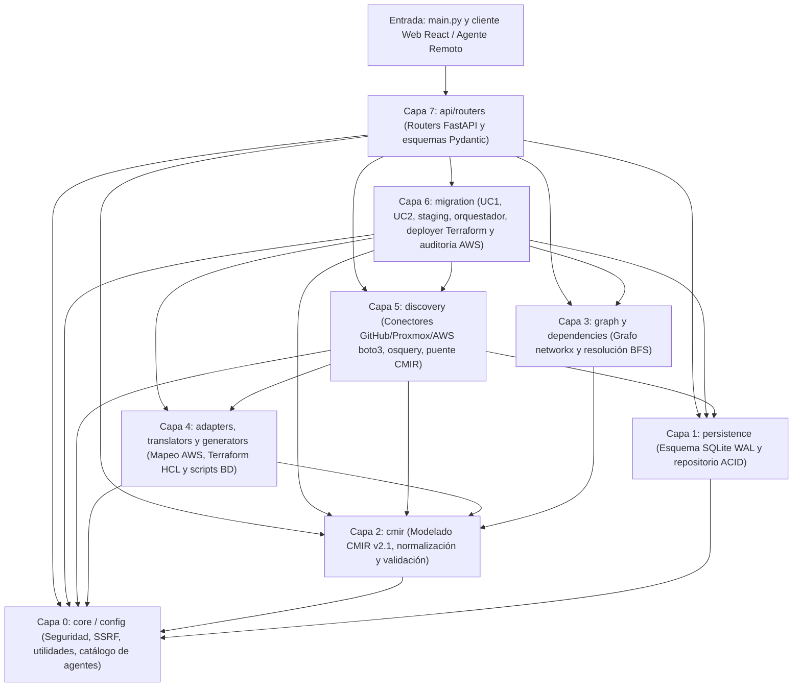

# Documentación Técnica y Mapa Completo del Código (`CloudMove`)

Guía de referencia completa sobre la estructura de carpetas, la arquitectura por capas, y el propósito de cada archivo de código, prueba, infraestructura y configuración del proyecto **CloudMove**.

> **Propósito del proyecto**: Plataforma web (React + FastAPI + Terraform + Agente remoto multiplataforma) orientada al descubrimiento técnico de aplicaciones y servidores (*on-premise* o GitHub), modelado semántico intermedio (**CMIR v2.1**), análisis epistémico de dependencias, traducción a arquitectura **AWS** y orquestación transaccional de despliegue en **Amazon Web Services**.

---

## 1. Índice Rápido de Carpetas

| Carpeta / Ámbito | Tipo | Descripción general |
| :--- | :--- | :--- |
| [Arquitectura por capas (DAG)](#2-arquitectura-general-y-flujo-entre-capas-dag) | Diseño | Flujo estricto de dependencias sin ciclos desde `core`/`persistence` hasta `api` y clientes. |
| [Raíz del repositorio](#3-archivos-en-la-raíz-del-repositorio) | Versionada | Orquestación Docker Compose, configuración `.env.example`, `.gitignore`, `.dockerignore`, `pyproject.toml`, recolector `osquery` independiente y documentación principal. |
| [`backend/`](#4-carpeta-backend) | Versionada | API REST FastAPI, seguridad SSRF/multi-usuario, persistencia SQLite WAL, motor CMIR v2.1, grafos `networkx`, adaptadores AWS, generadores Terraform y orquestador de migración. |
| [`backend/tests/`](#410-backendtests--suite-de-pruebas-automatizadas) | Versionada | Suite Pytest (aislada mediante `conftest.py` en directorios temporales) que cubre seguridad, CMIR, grafos, conectores, agentes, Terraform e integración UC1/UC2. |
| [`cloudmove_agent/`](#5-carpeta-cloudmove_agent) | Versionada | Paquete del agente instalable para Linux/macOS/Windows: demonio de *heartbeat* y tareas remotas, puente web local, recolector del SO e instaladores `systemd`/PowerShell. |
| [`frontend/`](#6-carpeta-frontend) | Versionada | Aplicación SPA en React 19 + Vite 8 + `@xyflow/react` + estética AWS Cloudscape v3 para descubrimiento, grafos, orquestación UC1/UC2, consola Terraform y auditoría AWS. |
| [`deploy/aws/`](#7-carpeta-deployaws) | Versionada | Infraestructura Terraform para desplegar el propio servidor web de **CloudMove** sobre Ubuntu 22.04 EC2 con Elastic IP, Docker Compose y proxy HTTPS Caddy. |
| [`generated/aws/`](#8-carpetas-generated-e-inventory) | Versionada | Plantilla base / ejemplo de salida Terraform HCL generada para AWS (`provider.tf`, `variables.tf`, `main.tf`, `outputs.tf`). |
| [`inventory/`](#8-carpetas-generated-e-inventory) | Versionada | Ejemplos de arquitecturas JSON (`onprem-example.json`, `enterprise-multicloud-example.json`, etc.) y discos binarios/manifiestos de muestra (`sample_images/`) para UC2 y pruebas. |
| [Carpetas locales / runtime](#9-carpetas-locales-y-de-runtime-no-versionadas--gitignore) | Ignorada en Git | Datos operativos SQLite WAL, sesiones importadas, bundles en staging (`uc2_staged`), despliegues Terraform por plan (`generated/deployments/`), `dist/`, `node_modules/` y `.venv/`. |

---

## 2. Arquitectura General y Flujo entre Capas (DAG)

El backend aplica una arquitectura estricta en grafo acíclico dirigido (**DAG**), sin ciclos entre módulos ni importaciones entre routers:



### Relación con los Clientes
- **Navegador Web (`frontend/`)**: Se comunica por HTTP/HTTPS contra `/api/v1/*` (proxied por Nginx en producción o Vite en desarrollo hacia el puerto `8000`). Las credenciales AWS del usuario, tokens SSH y PAT de GitHub viven aislados por pestaña en `sessionStorage` (`credentialVault.js`) y se envían de forma transitoria por petición sin persistirse en disco.
- **Agente Remoto (`cloudmove_agent/`)**: Se inscribe mediante tokens de un solo uso (`cmat_...`), realiza *heartbeat* periódico con protección anti-replay (`agent_nonces`), envía telemetría de hardware/SO/árbol de archivos, recibe tareas autorizadas por lista blanca (como exploración o *staging* UC2) y puede operar tanto en segundo plano (`agent_daemon.py`) como en modo puente local (`app.py`).

---

## 3. Archivos en la Raíz del Repositorio

| Archivo | Función detallada |
| :--- | :--- |
| `docker-compose.yml` | Define los servicios `backend` (FastAPI en `8000`, ligado por defecto a `127.0.0.1` y volúmenes `./backend/data`, `./generated`, `./inventory`, `./cloudmove_agent`) y `frontend` (Nginx sirviendo el SPA en `127.0.0.1:3000`). Configura `CLOUDMOVE_ALLOW_SERVER_AWS_FALLBACK=false` por defecto para operación multi-usuario. |
| `.dockerignore` | Excluye secretos (`.env`, `.env.*`, `*.pem`, `*.key`, llaves SSH), carpetas `deploy/`, `backend/data/`, `generated/`, cachés (`.venv`, `__pycache__`, `.pytest_cache`, `node_modules`) e imágenes de disco binarias al construir contenedores. |
| `.env.example` | Plantilla de variables de entorno documentadas para desarrollo y despliegue (`INVENTORY_PATH`, `AWS_OUTPUT_PATH`, `CORS_ORIGINS`, `CLOUDMOVE_API_URL`, `CLOUDMOVE_ALLOW_SERVER_AWS_FALLBACK`, `GITHUB_TOKEN` opcional, `VITE_API_URL`, `VITE_API_PROXY_TARGET`, `VITE_DEV_PORT`). |
| `.gitignore` | Evita subir secretos (`.env`, `*.pem`, `*.key`, `*id_rsa*`, `*id_ed25519*`), estado y variables Terraform (`*.tfstate*`, `*.tfvars*`), entornos Python/Node (`.venv/`, `node_modules/`, `dist/`), bases de datos SQLite (`*.db*`), sesiones (`discovery_sessions/`, `uc2_staged/`) y paquetes generados (`generated/deployments/`, `/generated/staging_images/`). |
| `pyproject.toml` | Configura Pytest (`pythonpath = ["backend"]`, `testpaths = ["backend/tests"]`) para ejecutar toda la suite desde la raíz del proyecto sin problemas de rutas. |
| `cloudmove_osquery_export.py` | Script CLI e interfaz web local autónoma (543 líneas) que ejecuta 16 consultas `osqueryi` de solo lectura sobre un equipo, empaqueta el inventario JSON normalizado y opcionalmente lo carga al backend de CloudMove. |
| `README.md` | Informe técnico detallado de arquitectura de 7 capas, flujos internos y operación web multi-usuario de CloudMove. |
| `README_CASO_1.md` | Informe técnico exhaustivo centrado en el Caso de Uso 1 (`app_source`): desde análisis estático de repositorios GitHub hasta la síntesis de Terraform en AWS. |

---

## 4. Carpeta `backend/`

Contiene el servidor API, lógica de dominio, motores de análisis y pruebas automatizadas.

| Archivo raíz de `backend/` | Función detallada |
| :--- | :--- |
| `backend/Dockerfile` | Imagen `python:3.11-slim` que instala herramientas de sistema (`qemu-utils`, `util-linux`, `git`, `curl`, `unzip`), **Terraform CLI v1.7.5**, **AWS CLI v2**, dependencias de `requirements.txt` y arranca `uvicorn app.main:app` en el puerto `8000`. |
| `backend/requirements.txt` | Dependencias Python principales del backend: `fastapi`, `uvicorn[standard]`, `pydantic`, `networkx`, `boto3`, `python-dotenv`, `pytest`, `httpx`. |

### 4.1 `backend/app/` — Núcleo y entrada de aplicación

| Archivo | Función detallada |
| :--- | :--- |
| `backend/app/main.py` | Inicializa `FastAPI` ("CloudMove Enterprise API" v2.0.0), configura CORS desde `CORS_ORIGINS`, añade middleware `X-Correlation-ID` por petición, registra manejadores globales para `ConnectorError` y excepciones no controladas, monta los 4 routers (`architecture`, `migration`, `discovery`, `agents`) y expone `/`, `/health`, `/api/health` y `/api/v1/health`. |
| `backend/app/config.py` | Resuelve rutas base (`PROJECT_ROOT`, `DATA_DIR` configurable vía `CLOUDMOVE_DATA_DIR`, `INVENTORY_PATH`, `AWS_OUTPUT_PATH`), carga `.env`, lee `CORS_ORIGINS`, bandera multi-usuario `ALLOW_SERVER_AWS_FALLBACK` (`CLOUDMOVE_ALLOW_SERVER_AWS_FALLBACK`), puertos y nivel de logs. |

### 4.2 `backend/app/core/` — Utilidades base y seguridad transversal (Capa 0)

| Archivo | Función detallada |
| :--- | :--- |
| `backend/app/core/__init__.py` | Inicializa el paquete compartido `app.core`. |
| `backend/app/core/security.py` | Controles de seguridad para despliegue web público en AWS: validación anti-path-traversal (`validate_safe_id`), bloqueo anti-SSRF contra IPs privadas/loopback/link-local/IMDS y *DNS rebinding* (`validate_public_target_host`, `validate_public_url`, `open_url_no_redirects` sin redirecciones HTTP), detección dinámica del servidor anfitrión mediante IMDSv2 (`get_control_plane_metadata`) y filtro `is_control_plane_agent` para proteger el servidor CloudMove frente a usuarios externos. |
| `backend/app/core/agents_catalog.py` | Desacopla utilidades compartidas de agentes sin importar routers ni persistencia directamente: `LATEST_AGENT_VERSION` (`2.2.0`), comparador semántico `is_version_gte`, resolución de URL pública vía headers *reverse proxy* (`extract_server_url`) y ensamblador `build_live_agent_discovery_payload` (con `db`/`db_factory` inyectados). |
| `backend/app/core/text_utils.py` | Helpers puros compartidos para todo el backend: `utc_now_iso` (timestamps UTC en ISO-8601) y `slugify` (normalización segura de identificadores ASCII en minúsculas). |

### 4.3 `backend/app/persistence/` — Persistencia transaccional ACID (Capa 1)

| Archivo | Función detallada |
| :--- | :--- |
| `backend/app/persistence/__init__.py` | Exporta la API del paquete de persistencia transaccional. |
| `backend/app/persistence/schema.py` | Define `SCHEMA_MIGRATIONS` (versiones `1.0.0`, `2.0.0`, `2.1.0`, `2.2.0`, `2.3.0` con tablas `schema_migrations`, `assets`, `migration_plans`, `audit_events`, `migration_stages`, `stage_executions`, `migration_artifacts`, `cloud_discovery_snapshots`, `organizations`, `agent_enrollment_tokens`, `agents`, `agent_tasks`, `agent_nonces`) y el corredor `apply_schema_migrations`. |
| `backend/app/persistence/transactional_db.py` | Implementa `TransactionalDatabase` sobre SQLite en modo `WAL` (`PRAGMA foreign_keys=ON`, `BEGIN IMMEDIATE` en escrituras), bloqueo optimista por versión (`ConcurrencyConflictError`), bloqueos atómicos de etapas (`StageLockedError`), idempotencia de ejecuciones, auditoría de eventos, ciclo de vida completo de agentes/tokens/nonces/tareas y migración segura de datos heredados JSON. |

### 4.4 `backend/app/cmir/` — Representación Intermedia Neutral CMIR v2.1 (Capa 2)

| Archivo | Función detallada |
| :--- | :--- |
| `backend/app/cmir/models.py` | Modelos Pydantic de CMIR v2.1: `CMIREvidence`, `CMIRTargetMapping`, `CMIRNode` (niveles jerárquicos 0..8, procedencia y estado epistémico `observed`/`inferred`/`unknown`), `CMIRRelationship`, `CMIR` y generador determinista de IDs `deterministic_node_id`. |
| `backend/app/cmir/builder.py` | Construye jerarquías padre-hijo y enlaces CMIR v2.1 mediante `build_hierarchical_cmir` y `build_cmir_hierarchy`. |
| `backend/app/cmir/normalizer.py` | Actualiza modelos heredados v1.0 / v2.0 a v2.1 sin pérdida de metadatos (`migrate_cmir_schema`) y normaliza diccionarios de inventario a objetos `CMIR` (`normalize_inventory`). |
| `backend/app/cmir/validator.py` | Ejecuta `validate_cmir` para verificar unicidad de IDs, integridad referencial de `parent_id` y aristas, conteo de relaciones inferidas/desconocidas y advertencias sobre recursos compartidos (`is_shared`). |

### 4.5 `backend/app/graph/` y `backend/app/dependencies/` — Grafos y Resolución Epistémica (Capa 3)

| Archivo | Función detallada |
| :--- | :--- |
| `backend/app/graph/builder.py` | Convierte un modelo `CMIR` en un grafo dirigido `networkx.DiGraph` (`build_graph`) distinguiendo aristas jerárquicas (`contains`, `parent_of`, `hosts`) de dependencias operativas. |
| `backend/app/graph/hierarchy.py` | Navegación e inspección del grafo (`get_breadcrumbs`, `get_children`, `get_descendants`) y proyección filtrada por padre, nivel o nodo en foco (`filter_graph_view`). |
| `backend/app/dependencies/resolver.py` | Recorre el grafo mediante búsqueda en anchura (`resolve_dependencies`) para calcular dependencias directas y transitivas de una selección, aislando relaciones `inferred` (desactivadas por defecto salvo confirmación) y protegiendo recursos marcados como compartidos (`is_shared`). |
| `backend/app/dependencies/validator.py` | Valida mediante `validate_migration_subgraph` que no existan dependencias irresolutas bloqueantes, advierte sobre ausencia de red (autogeneración de VPC), dependencias inferidas o compartidas, y autoriza o bloquea la generación IaC. |

### 4.6 `backend/app/adapters/`, `backend/app/translators/` y `backend/app/generators/` — Traducción AWS e IaC (Capa 4)

| Archivo | Función detallada |
| :--- | :--- |
| `backend/app/adapters/base.py` | Clase abstracta `BaseProviderAdapter` que define el contrato estándar (`translate_node`, `translate_cmir`, `validate_target_config`, `check_permissions_and_prerequisites`, `generate_iac`). |
| `backend/app/adapters/aws_adapter.py` | Implementación `AWSAdapter` con `AWS_RESOURCE_MAP` (mapeo completo desde tipos CMIR a recursos Terraform AWS: `aws_vpc`, `aws_subnet`, `aws_instance`, `aws_ecs_task_definition`, `aws_db_instance`, `aws_elasticache_cluster`, `aws_s3_bucket`, `aws_lb`, `aws_ami`, etc.), validación de regiones `VALID_AWS_REGIONS` y generación HCL modular. |
| `backend/app/translators/__init__.py` | Inicializador del paquete de traductores. |
| `backend/app/translators/aws.py` | Envoltura funcional `translate_cmir_to_aws` y `translate_resource` delegando en `AWSAdapter`. |
| `backend/app/generators/__init__.py` | Inicializador del paquete generador de artefactos. |
| `backend/app/generators/naming.py` | Sanitización y validación offline de identificadores Cloud/Terraform (`sanitize_hcl_id`, `sanitize_kebab_identifier` para RDS/ElastiCache, `sanitize_bucket_name` para S3 y `validate_hcl_naming_constraints`). |
| `backend/app/generators/terraform.py` | Generador determinista de infraestructura AWS modular (`generate_aws_terraform_files`, `generate_aws_terraform`, `format_terraform_code` vía `terraform fmt`): emite `provider.tf`, `variables.tf`, `main.tf` y `outputs.tf` parametrizando CIDRs (`ssh_ingress_cidr`, `db_ingress_cidr`), ALB/ASG o instancia única y dependencias filtradas. |
| `backend/app/generators/db_migration_script.py` | Genera el runbook ejecutable `migrate_database_data.sh` (`build_database_migration_script`) para aprovisionar roles/esquemas/extensiones PostgreSQL/PostGIS/Supabase y restaurar respaldos `.dump` o `.sql`. |
| `backend/app/generators/ai_translator.py` | Orquestador híbrido determinista + Gemini (`prepare_ai_payload`, `generate_auto_dockerfile_and_compose`, `generate_container_user_data_sh`, `generate_cheap_infrastructure`, `write_terraform_artifacts`). Auto-sintetiza arquitectura contenerizada HA (Multi-AZ ALB + ASG o Docker Compose sobre EC2) cuando no se configura `GEMINI_API_KEY` o falla la validación HCL. |

### 4.7 `backend/app/discovery/` — Motores de Descubrimiento Multi-Fuente (Capa 5)

| Archivo | Función detallada |
| :--- | :--- |
| `backend/app/discovery/__init__.py` | Expone la documentación e interfaces del paquete de descubrimiento. |
| `backend/app/discovery/models.py` | Define estados epistémicos (`DataState`), explicaciones por atributo (`DataPointExplanation`), incidencias (`DiscoveryIssue`) y contratos base para parsers multi-fuente (`BaseDiscoveryCollectorParser`, `OpenAudITCollectorAdapter`, `DatabaseCatalogCollectorSpec`). |
| `backend/app/discovery/osquery_parser.py` | Parser exhaustivo `OsqueryDiscoveryParser` (1,965 líneas) que valida esquemas `osquery`, preserva `0` vs `None`, deriva CIDRs, clasifica interfaces, procesos, servicios `systemd`, paquetes y dependencias sin inventar relaciones. |
| `backend/app/discovery/connectors.py` | Contratos y conectores seguros de descubrimiento: `SecretRedactor` (redacción automática de tokens/contraseñas), `validate_endpoint_against_ssrf`, `ArchitectureFileScanner`, `ProxmoxVEConnector` (paginación y *timeouts*), `DatabaseDiscoveryConnector` y `SimulatedCollectorFixture`. |
| `backend/app/discovery/github_connector.py` | Conector real `GitHubConnector`: valida URLs de GitHub, inspecciona ramas/tags, fija un **commit SHA inmutable** (`resolve_and_pin_commit`), construye el árbol jerárquico de carpetas (`build_hierarchical_tree`) y descarga tarballs hacia sandbox temporal con validación estricta anti-*path traversal* y anti-*symlinks*. |
| `backend/app/discovery/cloud_live_discovery.py` | Descubrimiento en vivo sobre AWS vía `boto3` multi-región (`AWSLiveDiscoveryConnector` sobre `sts`, `ec2`, `rds`, `s3`, `iam` usando únicamente las credenciales enviadas o controladas por config) y reconciliación de derivas entre snapshots (`CloudInventoryReconciler`). |
| `backend/app/discovery/cmir_bridge.py` | Convierte una sesión normalizada de descubrimiento en un modelo `CMIR` jerárquico y en nodos/aristas compatibles con `@xyflow/react` (`build_discovery_cmir_and_graph`). |
| `backend/app/discovery/exporters.py` | Exporta sesiones de descubrimiento a informes técnicos Markdown (`generate_markdown_report`) y diagramas Mermaid (`generate_mermaid_diagram`). |
| `backend/app/discovery/storage.py` | Almacén `DiscoverySessionStore` en memoria y disco para importar, recuperar y listar sesiones de inventario normalizadas. |
| `backend/app/discovery/terraform_bridge.py` | Traduce sesiones `osquery` normalizadas a infraestructura AWS modular (`recommend_ec2_instance_type`, `generate_discovery_aws_terraform`, `generate_discovery_terraform`) con trazabilidad directa hacia los recursos observados. |

### 4.8 `backend/app/migration/` — Casos de Uso, Orquestación y Despliegue Cloud (Capa 6)

| Archivo | Función detallada |
| :--- | :--- |
| `backend/app/migration/__init__.py` | Inicializa el paquete unificado de migración (UC1, UC2 y máquina de estados). |
| `backend/app/migration/orchestrator.py` | Motor central `MigrationOrchestrator` y máquina de estados (`DRAFT` → `DISCOVERING` → `ASSESSED` → `PLAN_READY` → `APPROVED` → `PREPARING` → `TESTING` → `READY_FOR_CUTOVER` → `COMPLETED` + `FAILED`/`CANCELLED`/`ROLLED_BACK`). Gestiona checkpoints por etapa, bloqueos atómicos, idempotencia de reintentos, auditoría y validación honesta de rollback. |
| `backend/app/migration/uc1_scanner.py` | Escáner estático de solo lectura para UC1 (`inspect_application_source`, `scan_local_filesystem_tree`, `discover_app_components_and_code`, `discover_database_backups_and_seeds`, `redact_env_value`): analiza proyectos Python/Node/Java/Go, `docker-compose*.yml`, volcados PostgreSQL/PostGIS `PGDMP`/`.sql` y redacta secretos. |
| `backend/app/migration/app_migrator.py` | Lógica de negocio UC1 (`app_source`): catálogo interactivo GitHub → AWS (`build_github_to_cloud_transformation_catalog`), construcción de CMIR (`build_application_cmir`), evaluación de viabilidad (`evaluate_app_migration_viability`), pipeline de 12 etapas (`build_app_migration_stages`), verificación funcional (`verify_application_health_and_functional_tests`) y generación de artefactos Terraform/systemd/scripts (`generate_app_migration_artifacts`). |
| `backend/app/migration/uc2_live_probe.py` | Forense binario y telemetría en vivo para UC2: valida firmas mágicas VMDK/QCOW2/VHD/RAW/OVA y particiones GPT/MBR (`inspect_binary_disk_header_and_structure`), crea copias aisladas verificadas por SHA-256 (`prepare_and_verify_staging_copy`) e inspecciona almacenamiento y SO en vivo del host o agente (`probe_live_storage_devices`, `capture_live_operating_system`). |
| `backend/app/migration/uc2_rehydration_portal.py` | Genera el script `user_data.sh` de rehidratación Cloud-Init (`build_uc2_rehydration_user_data`) para EC2 UC2 con servidor embebido multihilo `telemetry_server.py`, portal web de exploración/descarga, scripts `apply_tar.sh`/`sync_stage.sh` y verificación estricta del límite de 16,384 bytes de EC2 UserData. |
| `backend/app/migration/image_migrator.py` | Coordina UC2 (`vm_image`): catálogo de decisiones EBS/EC2/redes (`build_vm_image_transformation_catalog`), compatibilidad y las 8 dimensiones de fidelidad (`evaluate_vm_image_compatibility`), CMIR v2.1 (`build_vm_image_cmir`), flujo de etapas (`build_vm_image_migration_stages`), reporte comparativo origen vs destino (`generate_source_vs_target_diff_report`) y artefactos Terraform + conversión `qemu-img convert` (`generate_vm_image_migration_artifacts`). |
| `backend/app/migration/uc2_staging.py` | Gestor persistente de *staging* selectivo de carpetas/archivos del usuario para UC2: cálculo dinámico de cuota de disco (`get_dynamic_stage_budget_mb`), limpieza de sesiones antiguas, carga fragmentada por navegador o agente v2.2 (`save_stage_chunk`, `commit_stage_archive`, `save_browser_uploaded_batch`, `finalize_browser_stage`), tokens de descarga en tiempo constante y envío hacia EC2 (`push_stage_to_ec2`). |
| `backend/app/migration/replication_and_import.py` | Implementa `select_machine_migration_strategy` y `AWSMachineMigrationClient` para estrategias oficiales de replicación continua de bloques (**AWS MGN**) e importación nativa de snapshots/imágenes (**AWS VM Import/Export** vía S3 y `ec2:ImportImage`). |
| `backend/app/migration/cloud_deployer.py` | Ejecutor autónomo de despliegues `CloudDeploymentRunner`: materializa espacios de trabajo Terraform por `migration_id`, filtra estrictamente variables de entorno con listas blancas (`_build_env`), ejecuta comandos `terraform init/plan/apply/destroy` en streaming sin *deadlocks*, gestiona cancelaciones y delega inspección de estado y auditoría AWS. |
| `backend/app/migration/tfstate_inspector.py` | Analiza `terraform.tfstate` para extraer recursos aprovisionados e IPs (`inspect_tfstate`), sincroniza cambios de IP pública (`sync_tfstate_instance_ips`) y diagnostica errores CLI de Terraform (`diagnose_terraform_failure`). |
| `backend/app/migration/aws_audit.py` | Servicio de auditoría en vivo de cuentas AWS (`audit_aws_account`, `delete_aws_audit_resource` usando sesiones `boto3` con *timeouts* acotados) para listar y limpiar de manera controlada EC2, EBS, VPCs, Security Groups, Elastic IPs y workspaces locales. |
| `backend/app/migration/target_architecture.py` | Construye dinámicamente el modelo autoritativo CMIR de la arquitectura objetivo en AWS (`build_target_cloud_cmir`) reflejando las decisiones seleccionadas por el usuario (instancia EC2/ECS, RDS, caché, puertos, almacenamiento). |
| `backend/app/migration/deployment_guide_generator.py` | Genera guías de despliegue paso a paso en Markdown (`generate_deployment_guide`) adaptadas al plan UC1 o UC2 y a su configuración generada. |
| `backend/app/migration/external_services.py` | Detecta servicios BaaS o externos (`detect_external_services`: ej. Supabase, APIs externas) y ejecuta validaciones seguras sin almacenamiento persistente de secretos (`validate_external_credentials`). |

### 4.9 `backend/app/api/routers/` — Endpoints HTTP FastAPI (Capa 7)

| Archivo | Prefijo / Responsabilidad |
| :--- | :--- |
| `backend/app/api/routers/architecture.py` | Router `/api/v1/architecture`: expone el modelo CMIR (`/cmir`), grafo filtrado por jerarquía/enfoque (`/graph`), *breadcrumbs* y nodos hijos para explorar topología origen o destino en AWS. |
| `backend/app/api/routers/discovery.py` | Router `/api/v1/discovery`: colectores disponibles, telemetría del agente en vivo (`/agent-live`), importación/listado/consulta paginada (paquetes, procesos, servicios) de sesiones `osquery`, exportación Markdown/Mermaid/CMIR, puente a Terraform AWS y descarga del recolector e instaladores `osquery`. |
| `backend/app/api/routers/agents.py` | Router `/api/v1/agents`: emisión/listado de tokens de inscripción de un solo uso, enrolamiento de máquinas con identidad hardware, entrega del tarball del agente y scripts `install.sh` / `install.ps1` (con validación segura de token y URL), *heartbeat* con anti-replay, despacho y reporte de tareas, commit de archivos UC2 y revocación de agentes. |
| `backend/app/api/routers/migration.py` | Fachada delgada `/api/v1/migration` que compone los sub-routers modulares `migration_jobs`, `migration_uc1`, `migration_uc2` y `migration_cloud`, preservando compatibilidad de símbolos públicos y pruebas. |
| `backend/app/api/routers/migration_schemas.py` | Esquemas Pydantic de validación de entrada para creación de planes, aprobación, avance, rollback, validación GitHub, inspección UC1/UC2, comandos Terraform, auditoría AWS y *staging*. |
| `backend/app/api/routers/migration_helpers.py` | Helpers compartidos de routers de migración: validación de proveedor AWS, redacción recursiva de secretos al exportar (`sanitize_job_for_export`), sondeo HTTP/TCP anti-SSRF hacia instancias desplegadas (`sanitize_probe_host`, `fetch_uc2_ec2_file`) y sincronización tras `terraform apply` (`sync_job_after_terraform`). |
| `backend/app/api/routers/migration_jobs.py` | Endpoints del ciclo de vida del orquestador (`/providers`, `/dependencies`, `/validate`, `/generate`, `/jobs`, descarga de ZIP, descarga de guía Markdown, descarga de snapshot/disco/scripts VirtualBox/VMware, `assess`, `plan`, `approve`, `execute-next`, `retry`, `rollback`, `cancel` y estado de persistencia). |
| `backend/app/api/routers/migration_uc1.py` | Endpoints específicos de UC1: validar repositorio GitHub público/PAT (`/github/validate`), inspeccionar aplicación/dependencias, actualizar decisiones arquitectónicas y crear plan de migración guiada de 12 etapas. |
| `backend/app/api/routers/migration_uc2.py` | Endpoints específicos de UC2: inspección de imagen/SO en vivo, remediación de bloqueos, consulta/sondeo de dispositivos de almacenamiento, captura en vivo, orquestación de 13 etapas, proxies seguros de validación y descarga de archivos desde la EC2 destino (`/probe-uc2-*`) y APIs de *staging* del navegador (`/uc2-stage/*`). |
| `backend/app/api/routers/migration_cloud.py` | Endpoints de operaciones cloud reales: validación transitoria de credenciales BaaS y AWS STS, estado/logs/ejecución/cancelación/limpieza de comandos Terraform en vivo, regeneración de workspace, sondeo de instancia (`/probe-instance-status`) y auditoría/limpieza AWS (`/cloud-audit/aws`). |

### 4.10 `backend/tests/` — Suite de Pruebas Automatizadas

| Archivo | Qué verifica |
| :--- | :--- |
| `backend/tests/conftest.py` | Aísla toda la sesión de pruebas en un directorio temporal (`CLOUDMOVE_DATA_DIR` y singletons apuntando a `tmp`) evitando contaminar `backend/data/` o `generated/deployments/` del repositorio. |
| `backend/tests/test_adapters.py` | Traducción CMIR → AWS en `AWSAdapter`. |
| `backend/tests/test_agents.py` | Ciclo de tokens de inscripción, enrolamiento, *heartbeat*, revocación, lista blanca de capacidades y tareas, escaneo local, scripts de instalación e ingestión de inventario. |
| `backend/tests/test_cmir.py` | Carga de esquemas y construcción de jerarquía CMIR. |
| `backend/tests/test_dependencies.py` | Clasificación epistémica y resolución de dependencias en el grafo. |
| `backend/tests/test_discovery.py` | Validación y parsing de inventarios `osquery` (JSON malformado, `0` vs `None`, IPv4/IPv6, agregación sin relaciones inventadas), exportación/reimportación, scripts e instaladores, conector Proxmox con SSRF y `SecretRedactor`. |
| `backend/tests/test_evolution_use_cases.py` | Migración CMIR v2.1 con procedencia, separación de dependencias inferidas y compartidas, exclusividad AWS, flujo UC1 con redacción de secretos, flujo UC2 con bloqueo por RAM volátil, máquina de estados completa (aprobación, fallo, reintento, rollback) y captura de SO en vivo UC2. |
| `backend/tests/test_github_connector.py` | Parsing de URLs de GitHub, límites de cuota, fijación inmutable de commit SHA y checkout efímero, endpoints FastAPI, cabeceras de tarballs, manejo JSON de `ConnectorError` y árbol recursivo. |
| `backend/tests/test_graph.py` | Construcción del grafo dirigido y jerarquía de niveles. |
| `backend/tests/test_iac.py` | Generación Terraform modular (`provider.tf`, `variables.tf`, `main.tf`, `outputs.tf`), `terraform fmt`, modo HA contenerizado multi-capa con Supabase/ai_translator, decisiones interactivas UC1, interpolación `docker-compose` y prefijos numéricos en nombres RDS. |
| `backend/tests/test_reliability_and_discovery.py` | Endpoint `/api/v1/discovery/agent-live`, ausencia de *deadlocks* y cancelación limpia de subprocesos Terraform, puertos vacíos en arquitectura destino, entrega del recolector Python y proxies UC2. |
| `backend/tests/test_security_and_audit_fixes.py` | Aislamiento de entorno multi-usuario en `CloudDeploymentRunner`, anti-*path traversal*, protección del plano de control, bloqueos SSRF (IMDS, IPs privadas, redirecciones 302), validación de tarballs GitHub contra *symlinks*/traversal, tokens GitHub transitorios, credenciales dinámicas AWS en descubrimiento, guardia PostgreSQL, replay de *heartbeats* y endurecimiento CIDR en Terraform. |
| `backend/tests/test_uc2_file_staging.py` | Carga fragmentada de carpetas desde el navegador, *staging* de rutas desde agente v2.2, restricción de tamaño de `user_data.sh` (< 16 KB) y cobertura automática al inspeccionar UC2. |

---

## 5. Carpeta `cloudmove_agent/`

Implementa el agente instalable que corre en las máquinas origen (Linux, macOS o Windows) para descubrir hardware, procesos, servicios y archivos seleccionados por el usuario.

| Archivo | Función detallada |
| :--- | :--- |
| `cloudmove_agent/__init__.py` | Identifica el paquete Python `cloudmove_agent`. |
| `cloudmove_agent/agent_daemon.py` | Demonio principal `CloudMoveAgentDaemon`: ejecuta ciclo periódico de *heartbeat* autenticado con firma/nonce y hace *polling* de tareas despachadas por el servidor CloudMove (escaneo de sistema, empaquetado de carpetas UC2 y subida fragmentada). |
| `cloudmove_agent/app.py` | Servicio FastAPI puente local opcional: permite consultar salud del equipo/osquery (`/health`), catálogo de descargas de `osquery`, ejecutar descubrimiento en dos etapas e iniciar descargas locales de inventario. |
| `cloudmove_agent/system_collector.py` | Recolector multiplataforma de telemetría de solo lectura: identificador de máquina estable, CPU, RAM/swap, discos/particiones/puntos de montaje, interfaces de red, puertos en escucha, servicios `systemd`, bases de datos locales, procesos activos y árbol de archivos/carpetas de usuario (`collect_filesystem_tree`). |
| `cloudmove_agent/osquery_installer.py` | Detecta sistema operativo/arquitectura, consulta versiones oficiales de `osquery` en GitHub Releases, selecciona paquete óptimo, verifica binarios `osqueryi` y diagnostica disponibilidad local. |
| `cloudmove_agent/installer.py` | Utilidad CLI de instalación automatizada: comprueba conectividad con el servidor CloudMove, enrola usando token `cmat_...`, escribe configuración local y registra servicio `systemd`. |
| `cloudmove_agent/install.sh` | Script oficial de instalación Bash para Linux (`systemd`) compatible con Debian/Ubuntu y derivados RHEL. |
| `cloudmove_agent/install.ps1` | Script oficial de instalación PowerShell para hosts Windows. |
| `cloudmove_agent/uninstall.sh` | Desinstalador limpio para Linux (detiene servicio, borra unidades `systemd` y archivos del agente sin dejar residuos). |
| `cloudmove_agent/uninstall.ps1` | Desinstalador limpio en PowerShell para Windows. |
| `cloudmove_agent/cloudmove-agent.service` | Unidad `systemd` para mantener `agent_daemon.py` activo en segundo plano. |
| `cloudmove_agent/requirements.txt` | Dependencias ligeras del agente (`fastapi`, `uvicorn[standard]`). |
| `cloudmove_agent/README.md` | Documentación técnica interna del agente (protocolo, cabeceras, archivos en disco y desinstalación). |

---

## 6. Carpeta `frontend/`

Aplicación SPA construida con **React 19**, **Vite 8**, **`@xyflow/react`** y componentes inspirados en **AWS Cloudscape v3**.

### 6.1 Raíz de `frontend/` y `frontend/public/`

| Archivo | Función detallada |
| :--- | :--- |
| `frontend/Dockerfile` | Build multi-etapa: compila con `node:20-alpine` (`VITE_API_URL=/api`, `npm run build`) y sirve `dist` con `nginx:alpine` y `nginx.conf`. |
| `frontend/nginx.conf` | Configuración Nginx con gzip, fallback SPA hacia `index.html` y proxy inverso `/api/` y `/health` hacia `http://backend:8000` (con `client_max_body_size 128M` y timeouts de `300s`). |
| `frontend/package.json` | Scripts (`dev`, `build`, `lint`, `preview`) y dependencias (`react`, `react-dom`, `@xyflow/react`, `vite`, `oxlint`). |
| `frontend/package-lock.json` | Archivo de bloqueo exacto de versiones npm. |
| `frontend/vite.config.js` | Configura chunks manuales (`vendor-xyflow`, `vendor-react`), puerto de desarrollo y proxy de `/api` y `/health` al backend FastAPI. |
| `frontend/.oxlintrc.json` | Reglas del linter `oxlint` con plugins `react` y `oxc`. |
| `frontend/.env.example` | Plantilla de entorno frontend (`VITE_API_URL`, `VITE_API_PROXY_TARGET`, `VITE_DEV_PORT`). |
| `frontend/.gitignore` | Ignora `node_modules`, `dist`, `dist-ssr`, logs, `.env*` locales y carpetas de editor. |
| `frontend/index.html` | Documento HTML raíz con carga SPA de `src/main.jsx`. |
| `frontend/public/favicon.svg` | Ícono vectorial de la aplicación web. |
| `frontend/public/archify-aws-cmir.html`, `archify-aws-cmir.delivery.json`, `archify-aws-target.html`, `archify-aws-target.json` | Vistas y esquemas interactivos Archify embebidos para diagramas de referencia de topología AWS CMIR y arquitectura objetivo. |

### 6.2 `frontend/src/` — Punto de entrada, estilos y utilidades

| Archivo | Función detallada |
| :--- | :--- |
| `frontend/src/main.jsx` | Monta `<App />` en el DOM e importa estilos globales. |
| `frontend/src/App.jsx` | Orquestador principal de vistas: gestiona pestañas activas (`overview`, `discovery`, `architecture`, `migration`, `sources-targets`, `executions-audit`), selección de nodos del grafo CMIR, estado de credenciales por sesión, modal de vista previa IaC y carga inicial de contexto. |
| `frontend/src/index.css` | Importa `styles/main.css`. |
| `frontend/src/styles/tokens.css` | Tokens CSS de diseño AWS Cloudscape v3 (paleta, tipografía, espaciado, radios y sombras). |
| `frontend/src/styles/main.css` | Hojas de estilo globales de layout, tablas, tarjetas KPI, acordeones, badges epistémicos y consola Terraform. |
| `frontend/src/utils/apiClient.js` | Cliente HTTP centralizado (`apiFetch`, `getApiBase`, `buildUrl`, `resolveHealthyApiBase`) con detección de base API y manejo homogéneo de errores. |
| `frontend/src/utils/credentialVault.js` | Bóveda volátil de credenciales en `sessionStorage` aislada por pestaña de navegador (`saveSessionCredentials`, `getSessionCredentials`, `saveSessionAgentToken`, `getSessionAgentToken`, enmascaramiento de secretos y copia segura al portapapeles). |
| `frontend/src/utils/graphLayout.js` | Etiquetas humanas por tipo de recurso y arista (`RESOURCE_TYPE_LABELS`, `EDGE_LABELS`), agrupación por dominio arquitectónico y algoritmos de posicionamiento jerárquico/estratificado para `@xyflow/react`. |
| `frontend/src/utils/uc2StageClient.js` | Cliente para *staging* UC2 desde navegador o agente (`init`, carga fragmentada por lotes `uploadBrowserFolderToStage`, despacho a agente `dispatchUc2AgentStage` y consulta `fetchUc2StageStatus`). |

### 6.3 `frontend/src/components/` — Componentes organizados por dominio

- **`components/layout/`**
  - `AppShell.jsx`: Estructura marco principal (barra superior, navegación lateral colapsable y área de trabajo).
  - `Header.jsx`: Cabecera superior con título de vista activa (`TAB_LABELS`), acceso rápido a credenciales AWS temporales de sesión e indicadores de estado.
  - `Sidebar.jsx`: Define `CLOUDMOVE_NAV_GROUPS` y renderiza el menú lateral entre Consola Principal, Casos 1/2, Descubrimiento/Topología, Fuentes/Agentes y Auditoría AWS.
- **`components/cloudscape/`**
  - `AwsPrimitives.jsx`: Primitivas reutilizables inspiradas en Cloudscape (`AwsPageHeader`, `AwsContainer`, `AwsKeyValuePairs`, `AwsTabs`, `AwsStatusIndicator`, `AwsAlert`, `AwsEmptyState`).
- **`components/overview/`**
  - `EnvironmentOverviewWorkspace.jsx`: Pantalla de inicio (*Console Home*) con resumen en tiempo real de planes registrados, estado de persistencia, agentes conectados, snapshots y recursos AWS activos.
- **`components/sources/`**
  - `SourcesAndTargetsWorkspace.jsx`: Panel de gestión de orígenes y destinos: generación de tokens de inscripción de agentes, comandos de instalación Linux/Windows, despacho de tareas remotas, revocación de agentes y validación de repositorios GitHub.
- **`components/discovery/`**
  - `DiscoveryWorkspace.jsx`: Espacio principal de descubrimiento (`osquery` local/carga JSON o agente en vivo), listado de sesiones e importación.
  - `DiscoverySections.jsx`: Secciones detalladas colapsables (`SummarySection`, `HardwareSection`, `SoftwareSection`, `NetworkSection`, `RuntimeSection`, `DatabasesSection`, `AssessmentSection`, `AwsSuggestedDiagramSection`) con consulta paginada al backend.
  - `DiscoveryDiagramCanvas.jsx`: Lienzo interactivo de red/procesos/servicios descubiertos.
  - `ExplanationCard.jsx`: Tarjetas y badges de explicabilidad epistémica (`StateBadge`, `ExplanationCard`) mostrando evidencia y nivel de certeza.
- **`components/architecture/`**
  - `ArchifyArchitectureWorkspace.jsx`: Espacio interactivo del grafo CMIR v2.1 (modos `target` AWS o `source` on-premise, filtros por nivel/padre, *breadcrumbs* y apertura del inspector lateral).
  - `ArchifyDiagramRenderer.jsx`: Renderizador interactivo basado en `@xyflow/react` compartido entre vistas de arquitectura, planes UC1/UC2 y validación EC2.
  - `TechnicalIcons.jsx`: Iconografía técnica SVG para nodos AWS/on-premise, navegación y clasificación visual por dominio.
- **`components/inspector/`**
  - `ResourceInspector.jsx`: Drawer lateral redimensionable con pestañas para inspeccionar cualquier nodo seleccionado en el grafo.
  - `ResourceOverview.jsx`: Metadatos generales de proveedor, ubicación, entorno, categoría y nodo padre.
  - `DependenciesPanel.jsx`: Lista dependencias salientes requeridas y consumidores entrantes con navegación directa al nodo.
  - `ConfigurationPanel.jsx`: Atributos de runtime, subred CIDR, aislamiento y cifrado.
  - `MigrationPanel.jsx`: Estado epistémico CMIR v2.1, mapeo al adaptador AWS y alertas de dependencias compartidas protegidas.
- **`components/audit/`**
  - `ExecutionsAndAuditWorkspace.jsx`: Bitácora transaccional ACID de eventos por plan, resultados de pruebas pre/post *cutover*, validación Terraform, procedimientos de rollback y auditoría cloud integrada.
  - `AwsCloudAuditPanel.jsx`: Auditoría en vivo contra la cuenta AWS (EC2, EBS, VPC, Security Groups, Elastic IPs) usando las credenciales de sesión y eliminación segura de recursos/workspaces.
- **`components/migration/`** (Módulo principal de los Casos de Uso 1 y 2)
  - `MigrationOrchestratorWorkspace.jsx`: Orquestador de migraciones (gestión de estado, polling, ciclo de vida de planes, historial de planes, consola de etapas y coordinación entre el asistente y los inspectores).
  - `orchestratorConstants.js`: Constantes y helpers puros (`STATE_FLOW`, `OPERATIONAL_BADGE_MAP`, `deriveOperationalStatusBadge`, `USE_CASE_CARDS`, `FIDELITY_STATUS_META`, `PRIMARY_TRANSFORMATION_IDS`).
  - `UseCaseWizardPanel.jsx`: Contenedor del asistente paso 1 ("Crear migración"): tarjetas de selección de caso, nombre del plan, proveedor AWS y barra de acciones previas/creación.
  - `WizardCase1AppSection.jsx`: Formulario de origen UC1 (GitHub público/PAT con validación de ramas y árbol de archivos, o ruta local en servidor) y vista previa ejecutiva de pre-inspección (`WizardCase1PreInspectionPreview`).
  - `WizardCase2VmSection.jsx`: Flujo secuencial de 3 pasos para UC2 (token de agente → consulta remota de dispositivos/carpetas → selector de archivos y estrategia de consistencia *quiesced* / MGN / RAM volátil, o imagen `.vmdk`/`.qcow2`) + vista previa previa al plan.
  - `Case1InspectionPanels.jsx`: Pestañas del inspector para UC1 (`Case1SourceInspectionPanel` con evidencia de aplicación, trazabilidad Git, dependencias epistémicas, backups PostgreSQL/PostGIS y variables redactadas; `Case1CompatibilityInspectionPanel` con tabla de paridad).
  - `Case2InspectionPanels.jsx`: Pestañas del inspector para UC2 (`Case2SourceInspectionPanel` con cabecera binaria `qemu-img`, checksums SHA-256, tabla de discos/particiones, procesos `ps aux` e inventario FS; `Case2CompatibilityInspectionPanel` con las 8 dimensiones de fidelidad y comparativa origen vs EC2).
  - `GithubToCloudTransformationSelector.jsx`: Selector interactivo de decisiones arquitectónicas (modo cómputo, RDS/BaaS, tamaño EBS AWS Academy, perfil de instancia, política de puertos).
  - `VmOsToCloudTransformationMap.jsx`: Mapa visual de equivalencias sistema operativo/disco → servicios AWS EC2/EBS/Cloud-Init.
  - `TargetArchitectureView.jsx`: Diagrama en tiempo real de la arquitectura resultante en AWS según las decisiones elegidas.
  - `PlannedCloudStructureGraphModal.jsx`: Modal técnico contextual (`ContextualTechnicalModal`), botones de ayuda (`HelpTooltipButton`), resumen estructurado GitHub, pre-chequeos preventivos y modal gráfico de estructura planeada.
  - `RepositoryTreeViewer.jsx`: Explorador interactivo colapsable de carpetas, archivos y manifiestos detectados en el código fuente.
  - `UserFileSelectionPanel.jsx`: Selector interactivo de carpetas y archivos de usuario para UC2 con cálculo en vivo de cuota AWS Academy (Free Tier 30 GiB / volumen 100 GiB / cuenta 150 GiB) y persistencia en `sessionStorage`.
  - `Uc2StageTransferBox.jsx`: Monitor y disparador de transferencia/empaquetado de archivos UC2 hacia almacenamiento staging persistente desde el navegador o agente v2.2+.
  - `CloudRunbookGuidePanel.jsx`: Runbook interactivo paso a paso generado para el despliegue y operación del plan UC1 o UC2.
  - `AutomatedCloudDeployerPanel.jsx`: Consola Terraform interactiva en vivo (`verify-cloud` STS, `init/plan/apply/destroy`, streaming de logs en tiempo real, cancelación de procesos, inspección de recursos creados e integración con validación en EC2).
  - `Case2AwsValidationView.jsx`: Vista especializada de verificación post-despliegue para UC2 (sondeo al portal de telemetría en la EC2 destino, descarga segura del bundle `os_real_files_bundle.tar.gz`, visor de archivos migrados y diagrama Archify de validación).
  - `ExternalServicesCredentialsCard.jsx`: Tarjeta para detectar servicios externos (Supabase/BaaS/APIs) y validar credenciales de forma transitoria.
  - `MigrationPreviewModal.jsx`: Modal de previsualización de subgrafo CMIR y archivos Terraform generados desde el grafo global.
  - `IaCViewer.jsx`: Visor con pestañas por archivo generado (`main.tf`, `variables.tf`, `outputs.tf`, `user_data.sh`, etc.), copia al portapapeles y descarga individual.

---

## 7. Carpeta `deploy/aws/`

Contiene el Terraform para aprovisionar la infraestructura base donde corre públicamente la aplicación web **CloudMove** en AWS:

| Archivo | Función detallada |
| :--- | :--- |
| `deploy/aws/provider.tf` | Configura el proveedor `hashicorp/aws` parametrizado por región y credenciales temporales/estáticas. |
| `deploy/aws/variables.tf` | Declara región, credenciales AWS Academy (`access_key`, `secret_key`, `session_token`), tamaño de instancia/disco, llave pública SSH, `domain_name` opcional, `allowed_ssh_cidrs` y `expose_direct_api_port` (desactivado por defecto). |
| `deploy/aws/main.tf` | Provisiona Security Group (`cloudmove_sg` con puertos 80/443, SSH restringible por CIDR y API 8000 opcional), `aws_key_pair`, instancia Ubuntu 22.04 EC2 (`aws_instance.cloudmove_server`) con `user_data` renderizado vía `templatefile` y `aws_eip.cloudmove_ip`. |
| `deploy/aws/user_data.sh` | Script de arranque EC2: instala Docker y Caddy, configura proxy inverso HTTP/HTTPS automático (sobre dominio o `:80` IP elástica) hacia el frontend en `127.0.0.1:3000`. |
| `deploy/aws/outputs.tf` | Expone `instance_id`, `elastic_ip`, comando SSH, URLs por IP o dominio e instrucciones DNS. |
| `deploy/aws/terraform.tfvars.example` | Plantilla segura de variables para AWS Academy / EC2 sin exponer llaves reales. |
| `deploy/aws/.terraform.lock.hcl` | Archivo de bloqueo de versiones de providers Terraform. |

---

## 8. Carpetas `generated/` e `inventory/`

| Ruta | Contenido y función |
| :--- | :--- |
| `generated/aws/` | Conjunto Terraform base versionado (`provider.tf`, `variables.tf`, `main.tf`, `outputs.tf`, `terraform.tfvars.example`, `.terraform.lock.hcl`) usado como salida predeterminada de referencia para generación HCL hacia AWS. |
| `inventory/` | Arquitecturas de ejemplo en formato JSON (`onprem-example.json`, `onprem-enterprise-example.json`, `enterprise-multicloud-example.json`) para visualizar y probar grafos CMIR sin conexión a entornos externos. |
| `inventory/sample_images/` | Imágenes de disco de muestra (`debian12-erp-prod.vmdk`, `debian12-erp-prod-data.vmdk`, `ubuntu22-billing-app.qcow2`, `simulated_text_stub.vmdk`) y manifiesto `debian12-erp-prod.manifest.json` empleados en pruebas y demostraciones del Caso de Uso 2. |

---

## 9. Carpetas Locales y de Runtime (No Versionadas / `.gitignore`)

Directorios generados en tiempo de ejecución o compilación que permanecen exclusivamente locales por seguridad, tamaño o estado efímero:

- `backend/data/`: Base de datos transaccional `cloudmove_transactional.db` (`-wal`/`-shm`), sesiones importadas (`discovery_sessions/`), archivos subidos temporalmente en UC2 (`uc2_staged/`) y respaldos heredados JSON.
- `generated/deployments/`: Workspaces Terraform aislados por cada `migration_id` (`mig-app-*`, `mig-vm_-*`) junto con sus `.tfstate`, logs de ejecución y metadatos de estado.
- `generated/staging_images/`: Copias verificadas de discos virtuales convertidos y artefactos `cloud_init` por máquina capturada en UC2.
- `frontend/node_modules/` y `frontend/dist/`: Dependencias npm y compilado estático optimizado para Nginx.
- `.venv/`, `__pycache__/`, `.pytest_cache/`: Entorno virtual Python y cachés locales de ejecución/pruebas.

---

## 10. Comandos Esenciales de Desarrollo y Verificación

```bash
# 1. Ejecutar suite completa de pruebas del backend
.venv/bin/python3 -m pytest -v

# 2. Levantar backend en desarrollo
.venv/bin/uvicorn app.main:app --app-dir backend --reload --host 0.0.0.0 --port 8000

# 3. Verificar linter y compilar frontend para producción
npm --prefix frontend run lint
npm --prefix frontend run build

# 4. Levantar stack completo con Docker Compose
docker compose up --build
```
